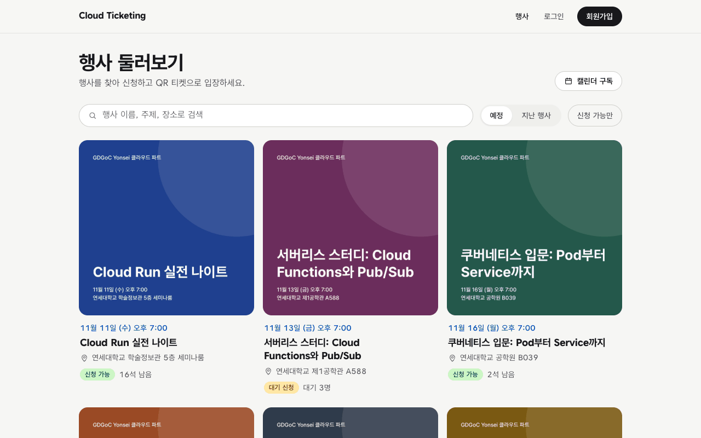
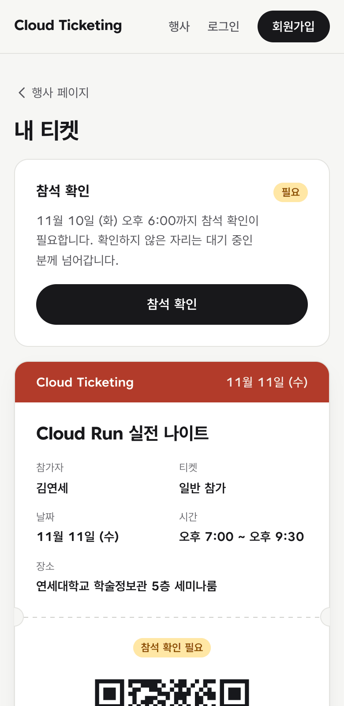
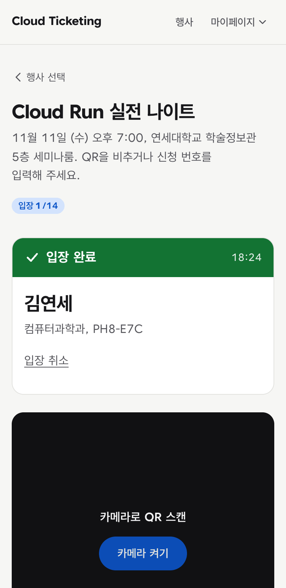
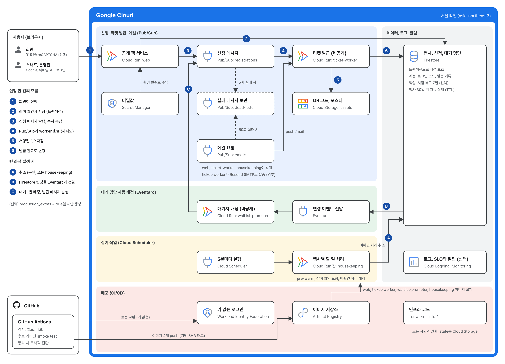

# Cloud Ticketing: serverless event ticketing on Google Cloud Run

행사를 열고, 신청을 받고, QR 티켓을 발급하고, 입구에서 체크인하는 서버리스 티켓팅 서비스입니다.
GDGoC Yonsei 클라우드 파트의 프로젝트이자 실습 과제입니다.
운영진은 관리 화면에서 행사를 만들어 공개하고, 참가자는 Google 계정이나 이메일로 받은 코드로 가입하고 로그인해 마이페이지에서 신청 내역을 봅니다.
Cloud Run의 핵심 기능마다 사용 이유가 분명하도록 구성했습니다.

| 상황 | 사용한 기능 |
|---|---|
| 신청 오픈 순간에 몰리는 방문자 | Cloud Run 자동 확장, 오픈 전 최소 인스턴스 증가(pre-warm) |
| 마지막 한 자리에 동시에 들어온 신청 | Firestore 트랜잭션 |
| 신청자가 기다리지 않아야 하는 느린 작업(QR 저장, 메일) | Pub/Sub push 구독, 재시도, dead letter |
| 취소로 생긴 빈 자리 | Firestore 변경 → Eventarc → waitlist-promoter |
| 행사마다 시각이 다른 작업(참석 확인 요청, 미확인 자리 해제) | Cloud Scheduler가 5분마다 실행하는 Cloud Run 잡 |
| 사용자에게 닿기 전에 확인하는 배포 | 트래픽 0%의 새 리비전, 후보 URL 검사, 실패 시 자동 복원 |
| 키 파일 없는 배포 권한 | Workload Identity Federation, 서비스별 서비스 계정 |

**기술 스택**: Python 3.13, FastAPI, Cloud Run(서비스 3개, 잡 1개), Firestore, Pub/Sub, Eventarc, Cloud Scheduler, Cloud Storage, Secret Manager, Terraform, GitHub Actions. 개인 프로젝트(2026년 11월).

**행사 한 번의 흐름**: 운영진이 행사 생성, 공개 → 신청 오픈 직전 web 사전 준비(pre-warm) → 좌석 마감 → 이후 신청은 대기 명단 →
취소가 생길 때마다 대기 1번 자동 배정, 메일 안내 → 마감 하루 전 참석 확인 요청 메일 → 마감 후 미확인 자리 해제, 대기자에게 →
행사 당일 QR 체크인

같은 코드가 두 곳에서 동작합니다. **노트북**에서는 SQLite, 폴더, 직접 HTTP 호출로, **Google Cloud**에서는
Firestore, Pub/Sub, Cloud Storage, Eventarc로 동작하며 `BACKEND=gcp` 환경 변수 하나로 바뀝니다(`shared/gcp.py`).

전체 안내서(코드, 다이어그램, 실행 방법 포함): [docs/guide.ko.md](docs/guide.ko.md)

| 행사 목록 | 모바일 티켓 | 입구 체크인 |
|---|---|---|
|  |  |  |

## 화면

| 주소 | 누가 | 내용 |
|---|---|---|
| `/` | 누구나 | 행사 카드 목록, 검색, 예정 / 지난 행사 전환, 신청 가능한 행사만 보기, 캘린더 구독 |
| `/events/{id}` | 누구나 | 행사 소개, 신청 카드, 신청 창(주문 요약, 개인정보 동의), 신청 완료 화면 |
| `/t/{id}` | 링크를 가진 사람 | 모바일 티켓(QR), 참석 확인, 신청 취소 |
| `/signup`, `/login` | 누구나 | Google 또는 이메일 코드로 가입과 로그인 |
| `/me` | 로그인한 사람 | 신청 내역, 프로필, 회원 탈퇴 |
| `/checkin` | `STAFF_EMAILS` | 행사 선택 후 QR 스캔 또는 코드 입력, 확인 후 입장 처리, 입장 취소 |
| `/admin` | `ADMIN_EMAILS` | 행사 목록, 생성과 수정, 공개 전환, 신청자 명단, CSV, 포스터 |
| `/terms`, `/privacy` | 누구나 | 이용약관, 개인정보처리방침 |

## 구조



| 로컬 | Google Cloud |
|---|---|
| `shared/store.py` SQLite (`.data/app.db`) | Firestore |
| `shared/bus.py` 직접 POST, 재시도, dead letter | Pub/Sub 토픽 2개(registrations, emails) + push 구독 + dead-letter 토픽 |
| `shared/blob.py` `.data/blobs/` 폴더 | Cloud Storage |
| `shared/store.py` 취소 시 CloudEvent 직접 발송 | Firestore 변경 → Eventarc 트리거 |
| `shared/mail.py` 보낸 메일함 폴더 (`/dev/outbox`) | Resend SMTP (설정 전에는 로그에만 기록) |
| `python -m jobs.housekeeping` | Cloud Run 잡 + Cloud Scheduler (5분마다) |
| `.env` 의 값 | 환경 변수, Secret Manager |

## 실행

Python 3.12 이상이 필요합니다.

```bash
python3 -m venv .venv && source .venv/bin/activate
pip install -r requirements.txt
cp .env.example .env
python dev.py                # 세 서비스 실행, 처음이면 예시 행사 9개 생성
python dev.py --open-in 5    # 5분 뒤 신청이 열리는 행사 추가 (카운트다운, pre-warm 확인용)
```

- 홈: http://localhost:8080
- 로그인: `organizer@example.com`(운영진) 또는 아무 이메일. 로컬에서는 메일이 발송되지 않고
  http://localhost:8080/dev/outbox 에 저장되므로, 로그인 코드는 그 화면에서 확인합니다.
- 관리: http://localhost:8080/admin, 체크인: http://localhost:8080/checkin (`door@example.com`은 체크인만 가능)

5분마다 도는 잡: `python -m jobs.housekeeping` (`--force-release`를 붙이면 마감 전이라도 미확인 자리 해제)  
테스트: `pip install pytest && python -m pytest`

## 컨테이너로 실행 (Docker)

`Dockerfile` 하나에 서비스마다 target이 있습니다. 네 이미지가 같은 기반 레이어(Python, 의존성, 공통 코드)를 함께 씁니다.

```bash
docker compose up --build                              # web: http://localhost:8080
docker compose run --rm housekeeping --force-release   # 잡 한 번 실행
docker compose down                                    # 정리 (데이터까지 지우려면 -v)
```

- web만 포트를 엽니다. ticket-worker와 waitlist-promoter는 compose 네트워크 안에서만 접근 가능하고, Cloud Run에서도 비공개입니다.
- 컨테이너는 root가 아닌 사용자(uid 10001)로 실행되고, 포트는 Cloud Run이 주는 `$PORT`를 따릅니다.

## CI/CD (GitHub Actions)

`.github/workflows/ci.yml`

```
push / PR ─▶ 검사 7개 (병렬) ─▶ build (이미지 4개) ─▶ push (main만) ─▶ 인프라 적용 ─▶ 새 리비전 시작 ─▶ 후보 검사 ─▶ 전환 ─▶ 실제 URL 확인
```

| 단계 | 언제 | 하는 일 |
|---|---|---|
| 검사 | 모든 push, PR | lint와 포맷(ruff), 테스트(pytest), 에뮬레이터 테스트(Firestore, Pub/Sub), 의존성 취약점(pip-audit), 이미지 취약점(Trivy), Dockerfile 검사(hadolint), Terraform 형식과 검증. 하나라도 실패하면 이후 단계 없음. 이미지 취약점은 `production_extras`에서만 실패로, 실습에서는 경고로 처리 |
| build | 검사 통과 후 | 이미지 4개를 병렬로 빌드, 레이어 캐시 사용 |
| push | main이고 GCP 변수가 있을 때 | 커밋 SHA 태그로 Artifact Registry에 올림. 키 파일 없이 로그인 |
| 인프라 적용 | `production_extras`이고 `infra/`가 바뀌었을 때 | plan을 저장하고, 삭제가 없으면 그 plan을 적용. 실패하면 이후 단계 없음 |
| 새 리비전 시작 | `DEPLOY_ENABLED=true`일 때 | ticket-worker, waitlist-promoter, web의 새 리비전을 트래픽 0%로 시작 |
| 후보 검사 | 시작 후 | web 후보 전용 URL에 smoke test |
| 전환 | 후보 검사 통과 후 | worker, housekeeping 잡(한 번 실행해 확인), web 순서로 새 버전에 전환 |
| 실제 URL 확인 | 전환 후 | 공개 주소에 요청 |
| 복원 | 위 단계 중 하나라도 실패 시 | 모든 서비스와 잡을 배포 전 상태로 복원 |

배포는 이미지만 바꿉니다([scripts/deploy.sh](scripts/deploy.sh)). 서비스의 설정(동시성, 최대 인스턴스, 서비스 계정, 비밀값)은 Terraform이 관리합니다.
리비전과 롤백 실습은 [docs/revisions.md](docs/revisions.md), 콜드 스타트 측정은 [docs/cold-start.md](docs/cold-start.md)에 있습니다.

## 인프라 (Terraform)

`infra/`의 Terraform이 Google Cloud 쪽 전부를 만듭니다: Cloud Run 서비스 3개와 잡 1개, Firestore, 버킷 1개,
Pub/Sub(재시도, dead letter), Eventarc Firestore 트리거, Cloud Scheduler, Secret Manager, 역할별 서비스 계정과 최소 권한,
GitHub Actions의 키 없는 로그인, 모니터링. 처음 설정하는 순서는 [안내서 8장](docs/guide.ko.md#8-실행-배포-정리)에 있습니다.

실습이 끝나면 `./infra/cleanup.sh --unlink-billing`으로 전부 삭제합니다.

## 직접 확인해 볼 것

실습 순서는 [docs/lab.ko.md](docs/lab.ko.md)에 있습니다. 템플릿으로 만든 자신의 저장소에서 `./lab up` 한 번으로 Terraform이 전부를 만들고(어떤 부품이 어느 부분에 속하는지는 [infra/README.md](infra/README.md)), GitHub와 메일 서비스는 직접 연결합니다. 그다음 앱에서 신청하고 취소하고 몰려 보면서, 실제로 오는 메일과 콘솔로 요청이 지나가는 길을 따라갑니다. Pub/Sub 가져오기 → 푸시 연결도 직접 하고, 몇 군데는 일부러 고장 내고 고치고 측정합니다. 재시도와 dead letter, 위조한 QR, 대기자 자동 배정 같은 실험은 [안내서 9장](docs/guide.ko.md#9-직접-해-볼-것)에, 신청 급증 재현은 [docs/load-test.md](docs/load-test.md)에 있습니다.

## 측정 결과

2026년 11월 9일, 빈 프로젝트에서 시작해 서울 리전에 배포한 뒤 방문자 300명, 좌석 100석, 대기 50명으로 측정했습니다. 두 번의 방문자 도착 속도는 달랐습니다.

| | 사전 준비 켬 | 사전 준비 끔 (인스턴스 0개에서 시작) |
|---|---|---|
| web 인스턴스 | 3개 유지 | 0 → 1 → 3 |
| 신청 응답 중앙값 | 150ms | 640ms |
| 신청 응답 95백분위 | 370ms | 10초 |
| 티켓 발급까지 중앙값 | 3.2초 | 10.2초 |
| 좌석, 대기 | 정확히 100, 50 | 정확히 100, 50 |

쉬던 web의 첫 요청은 4.46초, 이후 요청은 약 0.03초였습니다. 처음 배포할 때 만들어지는 자원은 85개입니다.

## 트러블슈팅

실제 배포에서만 드러난 문제와 해결입니다.

- **pre-warm이 최소 인스턴스를 바꾸지 못함**: 최소 인스턴스만 바꾸는 요청에도 Cloud Run은 web 서비스 계정에 대한 `actAs`를 요구했습니다(감사 로그로 확인). 잡에는 web 하나에 대한 권한만 주었습니다. [docs/cold-start.md](docs/cold-start.md)
- **Terraform 적용이 409로 실패**: 리비전 이름을 `ignore_changes`에 넣자 Terraform이 gcloud가 정한 예전 이름을 새 설정과 함께 보냈고, Cloud Run이 이를 거부했습니다. 리비전 이름은 무시하지 않습니다. [infra/run.tf](infra/run.tf)
- **노트북에서 통과한 plan이 CI에서 실패**: 서비스 계정의 요청은 자기 프로젝트의 API를 쓰므로, 꺼져 있던 Cloud Resource Manager API가 필요했습니다. [docs/ci-setup.md](docs/ci-setup.md)
- **`/healthz`가 404**: Cloud Run 앞단이 z로 끝나는 경로를 예약하고 직접 응답합니다. 상태 확인 경로를 `/health`로 바꿨습니다. [shared/runtime.py](shared/runtime.py)
- **waitlist-promoter가 Firestore 이벤트를 읽지 못함**: Eventarc는 Firestore 이벤트를 JSON이 아닌 protobuf로 전달합니다. 로컬 대역도 같은 형식을 보내도록 바꿔, 노트북에서도 같은 코드가 실행됩니다. [waitlist_promoter/main.py](waitlist_promoter/main.py)

커밋 메시지 앞의 [A01]~[A35], [L00]~은 2026년 11월 검토에서 나온 수정 항목의 번호입니다.
