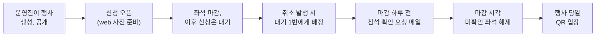
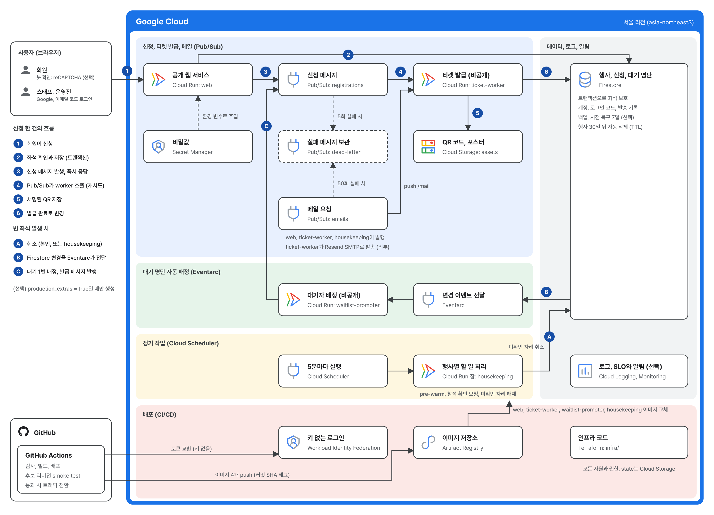
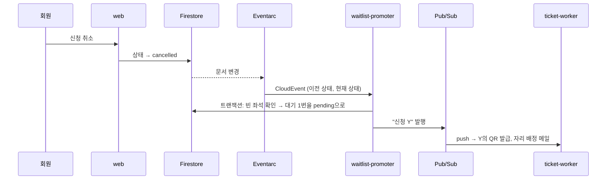
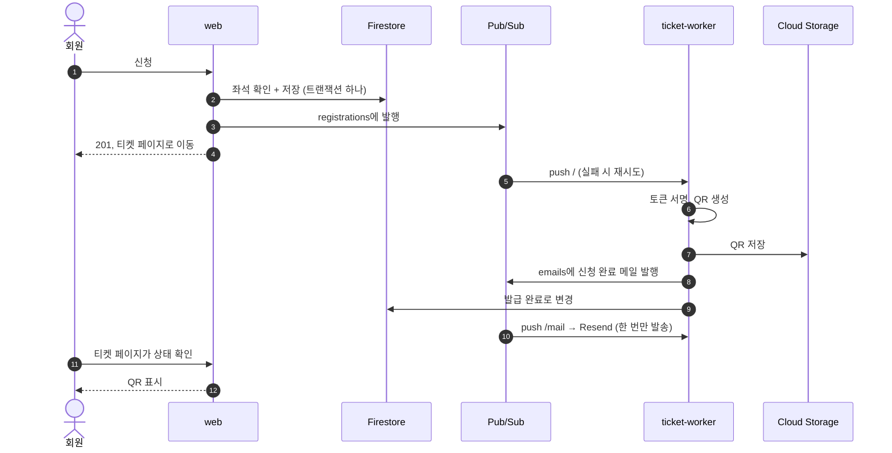
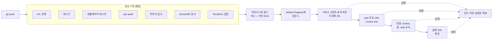

# Cloud Ticketing으로 배우는 Cloud Run: 전체 안내서

이 문서 하나로 프로젝트 전체를 이해할 수 있도록 서비스의 동작, 필요한 클라우드 개념, 핵심 코드, 인프라, 배포 과정, 실행 방법, 직접 해 볼 것을 차례로 설명합니다. 다른 파일을 열지 않아도 따라올 수 있으며, 전체 코드가 있는 파일 경로를 함께 적었습니다.

**목차**

0. [실습 안내](#0-실습-안내)
1. [서비스가 하는 일](#1-서비스가-하는-일)
2. [전체 구조](#2-전체-구조)
3. [알아야 할 Cloud Run 개념](#3-알아야-할-cloud-run-개념)
4. [코드 살펴보기](#4-코드-살펴보기)
5. [컨테이너](#5-컨테이너)
6. [인프라 (Terraform)](#6-인프라-terraform)
7. [배포: CI/CD, 리비전, 롤백](#7-배포-cicd-리비전-롤백)
8. [실행, 배포, 정리](#8-실행-배포-정리)
9. [직접 해 볼 것](#9-직접-해-볼-것)
10. [콜드 스타트와 신청 오픈 대비](#10-콜드-스타트와-신청-오픈-대비)
11. [운영 환경용 추가 구성](#11-운영-환경용-추가-구성)
12. [모니터링 (다음 회차)](#12-모니터링-다음-회차)
13. [현재의 한계](#13-현재의-한계)
14. [용어](#14-용어)

---

## 0. 실습 안내

2주 실습입니다. 전부 읽을 필요는 없으며, 아래 순서로 핵심만 따라가면 약 12~15시간이 걸립니다(추정치).

| 주차 | 할 일 | 볼 곳 |
|---|---|---|
| 1주차: 노트북에서 실행 | 서비스를 실행하고, 신청부터 체크인까지 직접 해 보고, 핵심 코드 읽기 | 1~5장, 8장의 "노트북에서 실행", 9장 |
| 2주차: Google Cloud에 배포 | 자신의 프로젝트에 배포하고, 리비전과 롤백, 콜드 스타트를 확인한 뒤 정리 | 6~7장, 8장의 "Google Cloud에 배포", 10장, [revisions.md](revisions.md) |

**건너뛰어도 되는 것:** 메일 발송 켜기(직접 관리하는 도메인이 필요합니다), Google 로그인, 11~12장. 메일을 켜지 않아도 운영진은 로그에서 코드를 확인해 로그인할 수 있습니다(8장).

**미리 필요한 것:** Python 3.12 이상(`python3 --version`으로 확인), Git, GitHub 계정, 2주차에는 `gcloud`, `terraform`, `gh`, `jq`. Cloud Shell에는 `terraform`이 없으므로 `./scripts/setup-cloudshell.sh`로 설치합니다(버전을 맞추기 위해 `gh`, `jq`도 함께 설치합니다). 모르는 용어는 14장에 있습니다.

**비용.** 2주차에는 결제 계정이나 크레딧이 있는 Google Cloud 프로젝트가 필요합니다. 기본 구성은 쉬는 동안 인스턴스를 0개까지 줄이지만 비용이 0은 아닙니다. 시작하기 전에 콘솔의 **결제 → 예산 및 알림**에서 예산 알림을 만들고, 끝나면 반드시 [정리 명령](#전부-정리)을 실행합니다.

**다 마친 뒤 설명할 수 있어야 하는 것**

1. 서비스와 잡의 차이는 무엇이고, housekeeping은 왜 잡인가요?
2. 신청한 사람이 티켓 발급을 기다리지 않는 이유는 무엇인가요?
3. Pub/Sub가 같은 메시지를 두 번 전달해도 티켓이 두 장 생기지 않는 이유는 무엇인가요?
4. 마지막 한 자리에 두 사람이 동시에 신청하면 어떻게 되나요?
5. 콜드 스타트는 무엇이고, 신청 오픈 전에 최소 인스턴스를 올리는 이유는 무엇인가요?
6. 리비전과 트래픽을 나누면 무엇을 할 수 있고, 배포가 실패하면 어떻게 되돌리나요?

---

## 1. 서비스가 하는 일

Cloud Ticketing은 Google Cloud Run에서 동작하는 행사 티켓팅 서비스입니다. 운영진은 행사를 만들어 공개하고, 회원은 신청해서 QR 티켓과 안내 메일을 받으며, 스태프는 입구에서 QR을 스캔합니다.

좌석 수가 정해져 있기 때문에 다음 기능이 필요합니다.

- 좌석이 모두 차면 이후 신청은 거절하지 않고 **대기 명단**에 올립니다.
- 좌석을 가진 사람이 취소하면 **대기 1번에게 좌석이 자동으로 배정**되고, 자리 배정 메일로 QR 티켓이 전달됩니다.
- 좌석을 받은 사람은 마감 시각(기본값은 행사 전날 18시)까지 **참석 확인**을 눌러야 합니다. 마감 하루 전에 아직 확인하지 않은 사람에게 요청 메일이 가고, **마감 시각에 참석 확인을 하지 않은 좌석은 해제**되어 대기자에게 넘어갑니다. 마감 6시간 전부터 받은 좌석은 참석 확인된 것으로 처리합니다.

**Google 계정**이나 **이메일로 받은 6자리 코드**로 가입하고 로그인합니다. 비밀번호는 어디에도 저장하지 않습니다. 로그인하지 않아도 신청할 수 있으며, 로그인하면 신청 양식이 자동으로 채워지고 마이페이지에서 신청 내역을 볼 수 있습니다.

| 주소 | 누가 | 내용 |
|---|---|---|
| `/` | 누구나 | 행사 카드 목록, 검색, 예정 / 지난 행사 전환, 신청 가능한 행사만 보기, 캘린더 구독 |
| `/events/{id}` | 누구나 | 행사 하나: 소개, 신청, 캘린더에 추가 |
| `/t/{id}` | 링크를 가진 사람 | 티켓: QR 코드, 참석 확인, 신청 취소 |
| `/login`, `/me` | 누구나 | 로그인, 마이페이지(신청 내역, 프로필의 이름과 소속, 회원 탈퇴) |
| `/checkin` | `STAFF_EMAILS`의 이메일 | 행사 선택 후 QR 스캔 또는 짧은 코드 입력 |
| `/admin` | `ADMIN_EMAILS`의 이메일 | 행사 생성, 수정, 공개, 신청자 명단, CSV, 포스터 |
| `/terms`, `/privacy` | 누구나 | 이용약관, 개인정보처리방침 (가입 양식에서 연결) |

행사 한 번의 흐름은 다음과 같습니다.



이 프로젝트는 클라우드 파트의 메인 실습이기도 합니다. 각 구성 요소는 행사 운영에 실제로 필요해서 존재하며, 각각 Google Cloud에서 작업을 실행하는 표준 방식 하나를 보여 줍니다.

---

## 2. 전체 구조



Cloud Run 아이콘이 있는 카드가 우리 코드이고, 나머지는 Google이 운영하는 서비스입니다. 숫자 1~6은 신청 한 건, 문자 A~C는 빈 좌석 하나의 흐름이며, `emails` 토픽은 모든 메일을 전달합니다. [4장](#4-코드-살펴보기)에서 자세히 설명합니다.

Cloud Run 자원은 네 개이고, 각각 하나의 역할을 맡습니다.

| 자원 | 종류 | 호출하는 쪽 | 역할 |
|---|---|---|---|
| **web** | 서비스, 공개 | 브라우저 | 페이지, 신청, 로그인, 마이페이지, 체크인, 관리 |
| **ticket-worker** | 서비스, 비공개 | Pub/Sub (내부 인그레스) | `/`: QR 서명과 저장, 발급 완료 표시. `/mail`: 메일 한 통 발송 |
| **waitlist-promoter** | 서비스, 비공개 | Eventarc (내부 인그레스) | 빈 좌석을 대기 1번에게 배정 |
| **housekeeping** | 잡 | Cloud Scheduler, 5분마다 | 행사마다 지금 할 일(사전 준비, 참석 확인 요청, 좌석 해제, 복구) 처리 후 종료 |

네 자원은 클라우드에서 작업이 시작되는 네 가지 방식에 하나씩 대응합니다.

| 작업이 시작되는 방식 | 이 프로젝트의 예 | 패턴 |
|---|---|---|
| 사람이 요청을 보내고 응답을 기다림 | 신청, 로그인 | **동기** 요청 |
| 메시지가 도착하고, 기다리는 사람은 없음 | "신청 X 발생" → QR 발급, "이 메일 발송" | **비동기** 메시지 |
| 데이터가 변경됨 | 신청이 취소 상태로 바뀜 | **이벤트** |
| 정해진 시각이 됨 | 5분마다: 신청 오픈, 참석 확인 요청, 마감 | **예약 실행** |

데이터는 컨테이너 밖에 둡니다. **Firestore**에는 행사, 신청, 좌석 수, 계정이, **Cloud Storage**에는 QR 이미지와 포스터가, **Secret Manager**에는 서명 키와 메일 서비스의 API 키가 있습니다. 메일은 **Resend SMTP 서버**를 통해 Google Cloud 밖으로 나갑니다.

---

## 3. 알아야 할 Cloud Run 개념

**컨테이너 이미지.** 앱과 실행에 필요한 모든 것을 하나로 묶은 파일 시스템 스냅샷입니다. Cloud Run은 이미지를 실행하며, 언어는 상관하지 않습니다.

**서비스와 잡.** *서비스*는 HTTPS 주소가 있고 요청을 기다립니다. *잡*은 주소가 없으며 실행되어 작업을 마치면 종료됩니다.

**인스턴스.** 실행 중인 컨테이너 하나입니다. Cloud Run은 요청이 오면 인스턴스를 시작하고, 요청이 없으면 **0개**까지 줄입니다. 이 프로젝트의 설정(요청 처리 중에만 CPU 할당)에서는 요청을 처리하는 동안에만 비용이 듭니다. 요청 없이 남아 있는 인스턴스는 비용이 없고, 최소 인스턴스만 낮은 유휴 요금으로 과금됩니다.

**동시성.** 인스턴스 하나가 동시에 처리하는 요청 수입니다. 1분 동안의 평균으로 처리 중인 요청이 이 수의 60%를 넘거나 CPU 사용률이 60%를 넘으면 Cloud Run이 인스턴스를 추가합니다. web은 대부분의 시간을 데이터베이스 응답을 기다리며 보내므로 한 인스턴스가 여러 요청을 처리하지만, FastAPI가 web의 함수를 스레드 40개로 실행하므로 40입니다. 그보다 많은 요청은 인스턴스 안에서 기다리게 되고, Cloud Run은 그 대기를 볼 수 없습니다. ticket-worker는 2이며, 최대 인스턴스 5와 곱하면 동시에 처리하는 티켓과 메일이 최대 10건으로 제한되어 메일 서비스와 Firestore를 보호합니다. 서명과 QR 생성 자체는 약 5ms로 짧고, 대부분의 시간은 외부 시스템을 기다립니다.

**최대 인스턴스.** 상한선입니다. 트래픽 급증이나 공격으로 인스턴스와 요금이 끝없이 늘거나 데이터베이스에 과부하가 걸리는 것을 막습니다.

**콜드 스타트.** 실행 중인 인스턴스가 없으면 다음 요청은 인스턴스가 시작될 때까지 기다립니다. 측정값은 약 **6초**, 인스턴스가 이미 실행 중일 때는 0.1초입니다. *최소 인스턴스*를 두면 피할 수 있지만 그만큼 비용이 듭니다.

**스테이트리스(stateless).** 인스턴스는 언제든 제거될 수 있고, 디스크는 인스턴스와 함께 사라지는 메모리입니다. 그래서 중요한 데이터는 컨테이너 안에 두지 않고 Firestore와 Cloud Storage에 저장합니다.

**요청 처리 중에만 CPU 할당.** 기본 설정에서 인스턴스는 요청을 처리하는 동안에만 CPU를 받습니다. 응답 후에 남은 작업은 멈출 수 있으므로, 오래 걸리거나 실패할 수 있는 작업(파일 저장, 메일 발송)은 백그라운드 스레드가 아니라 메시지로 다른 서비스에 넘깁니다.

**리비전.** 배포하거나 설정을 바꿀 때마다 이미지와 설정의 고정된 스냅샷이 하나 생깁니다. 트래픽을 여러 리비전에 나누거나 이전 리비전으로 되돌릴 수 있습니다.

**인그레스와 호출 권한.** *인그레스*는 요청이 어디서 올 수 있는지(인터넷 전체 또는 Google 내부), *run.invoker* 역할은 누가 호출할 수 있는지를 정합니다. 이 프로젝트의 비공개 서비스는 내부 인그레스이므로 인터넷에서 접근할 수 없고, 서비스에 직접 부여한 run.invoker는 하나뿐입니다. 프로젝트 수준 역할에도 호출 권한이 포함되며, 이 프로젝트에서는 배포 계정의 `run.developer`가 해당합니다. 기본 서비스 계정이 Editor 역할을 가진 프로젝트(2024년 5월 이전에 만든 조직이나 조직 밖의 프로젝트)에서는 그 계정에도 호출 권한이 있습니다.

**서비스 계정.** 프로그램의 신원입니다. 서비스마다 별도 계정으로 실행하고 필요한 권한만 줍니다(최소 권한).

---

## 4. 코드 살펴보기

### 4.1 프로젝트 구조

```
web/                  공개 서비스. main.py가 앱을 조립하고, 영역마다 파일이 하나
  common.py           템플릿, 서식, 로그인 확인, 행사 공통 함수
  events.py           누구나 접근: 행사 페이지, 티켓, 신청
  auth.py             로그인, 스태프 화면 입구 확인
  account.py          마이페이지
  door.py             체크인 (스태프)
  admin.py            행사 관리 (운영진)
ticket_worker/        비공개 서비스: Pub/Sub push → QR 티켓(/), 메일 발송(/mail)
waitlist_promoter/    비공개 서비스: Firestore 변경(Eventarc) → 대기자 배정
jobs/                 housekeeping.py: 5분마다 실행되는 잡
shared/
  config.py           모든 설정을 환경 변수에서 읽음
  models.py           행사와 신청의 정의
  store.py            데이터: 로컬에서는 SQLite …
  gcp.py              … Google Cloud에서는 Firestore, Pub/Sub, Cloud Storage
  bus.py              메시지: 로컬에서는 직접 HTTP 호출, Google Cloud에서는 Pub/Sub
  blob.py             파일: 로컬에서는 폴더, Google Cloud에서는 Cloud Storage
  mail.py             메일: 종류별 내용과 발송 방법
  tokens.py           서명된 QR 토큰과 세션 쿠키
  guard.py            요청 속도 제한과 봇 확인
  demo.py             새 로컬 데이터베이스용 예시 행사
infra/                Terraform: Google Cloud 자원 전체
.github/workflows/    CI/CD
Dockerfile            파일 하나, 이미지 네 개
dev.py                노트북에서 서비스 세 개 실행
```

### 4.2 코드 하나, 실행 환경 둘

같은 코드가 노트북(SQLite, 폴더, 직접 HTTP 호출, 폴더에 저장되는 메일)과 Google Cloud(Firestore, Cloud Storage, Pub/Sub, Eventarc, Resend)에서 모두 동작하며, 환경 변수 하나로 전환됩니다. `shared/store.py` 끝부분:

```python
# On Google Cloud the same functions run against Firestore (shared/gcp.py)
if os.environ.get("BACKEND") == "gcp":
    from .gcp import (add_dead_letter, cancel, check_in, email_was_sent, ..., register, stats, ...)
```

서비스는 `store.register(...)`, `bus.publish(...)`, `mail.request(...)`만 호출하므로 어느 쪽이 응답하는지 알지 못합니다. 로컬 대체 구현은 메시지 형식, 재시도, 이벤트 데이터까지 클라우드와 같게 동작하도록 만들었습니다.

모든 설정은 환경 변수에서 읽으므로(`shared/config.py`) 같은 이미지가 어디서나 실행됩니다. Cloud Run에서는 Terraform이 환경 변수를 설정하고, 비밀값도 Secret Manager에서 환경 변수로 전달됩니다. 행사는 설정이 아니라 데이터베이스에 저장합니다.

### 4.3 데이터베이스에 저장되는 행사

행사(`shared/models.py`의 `Event`)에는 이름, 장소, 시각(`starts_at`, 신청 기간 `opens_at`과 `closes_at`, `confirm_deadline`), `seat_limit`, `waitlist_limit`, `published`가 있습니다. Firestore에서는 문서 두 개로 저장합니다(`shared/gcp.py`).

```
# events/{event_id}      the event itself: title, times, seat limits
# event_counts/{id}      seat counter and status counts, updated in the same
#                        transaction as the change they count. Kept apart from
#                        events/ so an organizer editing an event never
#                        collides with the signup transactions.
```

좌석 수를 별도 문서에 두기 때문에, 운영진이 행사 정보를 고쳐도 신청 트랜잭션과 충돌하지 않습니다. 운영진은 `/admin`(행사 관리)에서 **새 행사 만들기**로 행사를 만들고, **공개하기**를 누르기 전까지 행사는 비공개입니다. 행사별 관리 화면에는 현황, 신청자 명단, CSV 내보내기, 포스터 업로드가 있습니다. 새 로컬 데이터베이스에는 예시 행사 아홉 개가 들어가고(`shared/demo.py`), Google Cloud에는 아무것도 미리 넣지 않습니다.

### 4.4 신청 (web)

`web/events.py`, 일부 생략:

```python
@app.post("/api/events/{event_id}/registrations", status_code=201)
def api_register(request: Request, event_id: str, body: SignupIn):
    # Abuse protection first: it is cheaper than a database transaction
    # ... at most 100 signups a minute per IP, and the bot check ...
    ev = store.get_event(event_id)
    if ev is None or not ev.published:
        return error(404, "not_found", "행사를 찾을 수 없습니다.")
    # ... check name, email and 소속; check that signups are open ...
    try:
        reg = store.register(ev, name, email, body.affiliation)
    except store.Full:
        return error(409, "full", "자리와 대기 명단이 모두 마감되었습니다.")
    except store.AlreadyRegistered:
        return error(409, "duplicate", "이미 이 이메일로 신청한 기록이 있습니다.")

    if reg.status == "pending":  # a waitlisted person gets a ticket only when promoted
        try:
            bus.publish("registrations", {"registration_id": reg.id})
        except Exception:
            log.exception("publish failed for %s; the housekeeping job will retry", reg.id)
    else:
        mail.request("waitlisted", reg.email, registration_id=reg.id)
    return {"id": reg.id, "code": reg.code, "status": reg.status, "ticket_url": f"/t/{reg.id}"}
```

신청자는 트랜잭션과 메시지 발행이 끝날 때까지, 즉 1초도 안 되는 시간만 기다립니다. 티켓과 메일은 다른 서비스가 처리합니다.

### 4.5 좌석 트랜잭션 (Firestore)

티켓 시스템에서 가장 어려운 부분은 마지막 좌석입니다. 두 사람이 같은 순간에 신청 버튼을 누를 수 있기 때문입니다. `shared/gcp.py`, 일부 생략:

```python
@firestore.transactional
def attempt(tx):
    snapshot = _counts_ref(ev.id).get(transaction=tx)
    counts = (snapshot.to_dict() or {}) if snapshot.exists else {}
    held, waiting = counts.get("held", 0), counts.get(WAITLISTED, 0)
    if _email_ref(ev.id, email).get(transaction=tx).exists:
        raise AlreadyRegistered()
    status = "pending"
    if held >= ev.seat_limit or waiting:  # a seat free while people wait is theirs
        if waiting >= ev.waitlist_limit:
            raise Full()
        status = WAITLISTED
    ...
    if status == WAITLISTED:
        tx.set(_counts_ref(ev.id), {WAITLISTED: waiting + 1}, merge=True)
    else:
        tx.set(_counts_ref(ev.id), {"held": held + 1, "pending": Increment(1)}, merge=True)
```

**트랜잭션** 안의 읽기와 쓰기는 하나의 단계로 처리됩니다. 두 트랜잭션이 같은 좌석 수를 동시에 읽으면 Firestore는 하나만 반영하고 다른 하나를 중단시키며, 중단된 쪽은 다시 시도해 바뀐 좌석 수를 봅니다. CI의 Firestore 에뮬레이터 테스트에서 좌석 10석, 대기 10명인 행사에 40명이 스레드 10개로 동시에 신청하면 항상 좌석 10명, 대기 10명, 거절 20명이 됩니다.

한 행사의 모든 신청이 같은 `event_counts` 문서를 갱신합니다. Firestore는 문서 하나에 초당 약 1회 쓰기를 안정적으로 처리하며, 신청이 몰리면 트랜잭션끼리 충돌하고 무작위로 점점 길어지는 대기 후 재시도됩니다(`shared/gcp.py`의 `_run`). 신청이 몰릴 때 조금 느려질 뿐 결과는 틀리지 않습니다.

### 4.6 메시지 발행 (Pub/Sub)

```python
def publish(topic: str, data: dict) -> None:
    # Wait for Pub/Sub to accept the message before the request returns. Cloud Run
    # gives an instance CPU only while it handles a request, so a background
    # thread started here could stall after the response is sent.
    ...
    _publisher().publish(path, json.dumps(data).encode(), **attributes).result(timeout=30)
```

**Pub/Sub**는 Google의 메시지 서비스입니다. *토픽*이 메시지를 받고, *push 구독*이 각 메시지를 정해진 주소로 전달합니다. 토픽은 두 개이고 둘 다 ticket-worker로 갑니다. `registrations`는 `/`(티켓 생성), `emails`는 `/mail`(메일 한 통 발송)입니다. 요청의 trace id가 메시지에 함께 실려 두 서비스의 로그가 하나로 이어집니다(12장).

발행에 실패해도 좌석은 이미 저장되었으므로 web은 201로 응답합니다. 5분마다 실행되는 잡이 5분 넘게 "발급 중"인 신청의 메시지를 다시 발행합니다(4.10). 이렇게 해도 안전한 이유는 다음 절에 있습니다.

### 4.7 티켓 발급 (ticket-worker)

`ticket_worker/main.py`, 일부 생략:

```python
def issue(envelope: dict):
    data = bus.read_envelope(envelope)
    registration_id = data["registration_id"]

    reg = store.get(registration_id)
    if reg is None or reg.status != "pending":
        # Already issued, cancelled, or unknown: nothing to do. Answer 2xx so
        # Pub/Sub stops redelivering. This is what makes the handler idempotent.
        return Response(status_code=204)
    ...
    blob.put(f"tickets/{registration_id}.svg", tokens.ticket_qr(reg.event_id, registration_id))
    # Ask for the email first. If that fails, the 5xx brings this message back; had the
    # ticket been marked issued already, the retry would skip it and nobody would be
    # told. A repeated request is harmless: mail.send sends each email once.
    # A person moved up from the waitlist gets "자리 배정", everyone else "신청 완료"
    kind = "promoted" if reg.promoted_at else "ticket_issued"
    if not mail.request(kind, reg.email, registration_id=registration_id):
        return Response("could not queue the email", status_code=500)
    store.mark_issued(registration_id)  # False for a duplicate delivery: count each ticket once
    return Response(status_code=204)
```

비동기 작업을 안전하게 만드는 규칙은 세 가지입니다.

- **작업을 마쳤을 때만 2xx로 응답합니다.** 다른 응답을 보내면 Pub/Sub가 점점 긴 간격(10초에서 300초)으로 다시 전달합니다.
- **재시도에 모두 실패한 메시지는 `dead-letter` 토픽으로 옮겨집니다.** 메시지가 조용히 사라지지 않습니다. 티켓 메시지는 5회, 메일은 50회(약 4시간)까지 시도합니다. 티켓은 잡이 다시 발행하지만 메일을 다시 보내는 곳은 없기 때문입니다. 두 토픽이 함께 쓰며, 관리 화면에 쌓인 메시지가 표시됩니다. 원인을 고친 뒤 `scripts/replay-dead-letters.sh --replay`로 다시 보냅니다.
- **처리를 멱등으로 만듭니다.** Pub/Sub는 메시지를 *최소 한 번* 전달하므로 같은 메시지가 두 번 올 수 있습니다. 맨 위의 상태 확인 덕분에 두 번째 전달은 아무것도 바꾸지 않습니다.

QR에는 `{event_id}/{registration_id}`를 서명한 토큰(`payload.signature`, HMAC)이 들어 있습니다. 내용은 누구나 읽을 수 있지만 비밀 키 없이는 유효한 토큰을 만들 수 없으므로, 위조한 티켓은 입구에서 거부됩니다. 행사 ID도 서명에 포함되므로 다른 행사의 진짜 티켓도 거부됩니다(`wrong_event`, "다른 행사의 티켓").

### 4.8 Pub/Sub를 통한 메일 발송

요청을 처리하는 도중에는 메일을 보내지 않습니다. web, ticket-worker, housekeeping은 `mail.request(kind, to, ...)`(`shared/mail.py`)를 호출하고, 이 함수는 `emails` 토픽에 발행만 합니다. 메일 서버가 느리거나 실패해도 메시지가 늦어질 뿐 신청은 영향을 받지 않습니다.

| `kind` | 제목 | 요청하는 쪽 |
|---|---|---|
| `login_code` | 인증 코드 123456 | web, 코드 받기를 누를 때 |
| `ticket_issued` / `promoted` | 신청 완료 / 자리 배정 | ticket-worker, 티켓 발급 후 |
| `waitlisted` | 대기 신청 완료 | web, 대기 명단에 오를 때 |
| `cancelled` | 신청 취소 | web, 신청 취소를 누를 때 |
| `confirm_reminder` / `released` | 참석 확인 요청 / 자리 반환 안내 | housekeeping (4.10) |

ticket-worker의 `/mail`은 `send`를 호출합니다.

```python
def send(message: dict) -> bool:
    key = f"{message['kind']}:{message['registration_id']}" if "registration_id" in message else None
    if key and store.email_was_sent(key):
        log.info("already sent %s; skipping the repeat", key)
        return False
    _deliver(message)
    if key:
        store.record_email_sent(key)
    return True
```

**발송 기록**은 `sent_emails/{kind}:{신청 ID}` 문서입니다. 같은 메시지가 다시 오면 기록이 있으므로 보내지 않습니다. 기록은 발송한 뒤에 남깁니다. 그 사이에 인스턴스가 죽으면 같은 메일이 한 번 더 갈 수 있지만, 티켓 메일이 사라지는 것보다 낫습니다. Pub/Sub와 같은 **최소 한 번**(at-least-once) 방식입니다. 메일 본문은 발송 시점의 데이터로 만들기 때문에 대기 순번 같은 정보가 항상 최신입니다.

메일이 어디로 가는지는 `MAIL_BACKEND`가 정합니다. `outbox`(로컬 기본값)는 폴더에 저장하고 http://localhost:8080/dev/outbox (보낸 메일함)에 보여 줍니다. `smtp`는 Resend의 587 포트로 API 키를 써서 보냅니다. `log`(Google Cloud에서 메일을 켜기 전)는 아무것도 보내지 않고 운영진의 로그인 코드만 로그에 남깁니다(8장).

### 4.9 이메일 코드 로그인

이메일을 입력하면 6자리 코드를 받고, 그 코드를 입력해 주소의 주인임을 확인합니다. `web/auth.py`, 일부 생략:

```python
code = f"{secrets.randbelow(10**6):06d}"
expires = (now() + timedelta(minutes=CODE_MINUTES)).isoformat(timespec="seconds")
store.save_login_code(email, code_hash(email, code), expires)
mail.request("login_code", email, code=code)
```

- 코드는 키가 있는 해시(`code_hash`, `SESSION_SECRET`을 쓴 HMAC)로만 저장하므로, 데이터베이스가 유출되어도 코드를 알 수 없습니다.
- 코드는 **10분** 동안 **5회**까지 입력할 수 있고, 5회 틀리면 맞는 코드도 더 이상 통하지 않습니다. 같은 이메일로는 1분에 한 번, 같은 IP에서는 1분에 5번까지 코드를 요청할 수 있습니다.
- 코드가 맞으면 **30일** 동안 유지되는 **세션 쿠키**를 줍니다. 이메일을 `SESSION_SECRET`으로 서명한 값이며, HTTP 전용이고 Cloud Run에서는 HTTPS 전용입니다.
- **스태프와 운영진은 별도 계정이 아닙니다.** `STAFF_EMAILS`, `ADMIN_EMAILS`에 있는 이메일일 뿐입니다(운영진은 체크인도 가능). 목록은 요청마다 확인하며, 상단 메뉴의 체크인과 관리 링크는 해당하는 사람에게만 보입니다.

회원가입(`/signup`)도 같은 흐름이며, 이름을 함께 받아 코드가 맞을 때 계정을 만듭니다. 마이페이지(`/me`)는 이메일로 신청 내역을 찾습니다. 프로필의 이름과 소속은 신청 양식에 자동으로 채워집니다. **회원 탈퇴**는 프로필을 삭제하고, 아직 시작하지 않은 행사의 신청을 취소합니다.

**Google 로그인**도 같은 세션 쿠키로 끝납니다. Google 버튼이 서명된 ID 토큰을 돌려주면 `POST /api/auth/google`이 `google-auth`로 서명, 대상, 발급자, 만료를 확인합니다. 이 서비스에서는 이메일 주소가 곧 계정이므로, Google이 보증하는 주소만 받습니다. Gmail이나 Workspace 도메인(`hd`)이 여기에 해당합니다. 개인 Google 계정에 등록한 외부 주소는 확인 후 주인이 바뀔 수 있어 이메일 코드로 로그인합니다. Google 클라이언트 ID가 있고 메일이 꺼져 있으면 로그인 화면에는 Google 버튼만 표시됩니다. 클라이언트 ID는 공개 값이며 `GOOGLE_CLIENT_ID`에서 읽습니다.

### 4.10 빈 좌석 배정과 5분마다 실행되는 잡 (Eventarc, Cloud Scheduler)

취소하면 `store.cancel`이 신청의 상태를 `cancelled`로 바꿉니다. **Firestore 문서의 이 변경 자체가 이벤트**이며, **Eventarc**가 이를 CloudEvent로 waitlist-promoter에 전달합니다(protobuf 형식, Google의 `google-events` 라이브러리로 해석).



`waitlist_promoter/main.py`, 일부 생략:

```python
def promote(before: str, after: str, subject: str) -> Response:
    if not (before in store.ACTIVE and after == "cancelled"):
        return Response(status_code=204)  # not a freed seat: nothing to do
    ...
    ...
    promoted = waitlist.fill_free_seats(ev)  # shared/waitlist.py

# shared/waitlist.py
def fill_free_seats(ev):
    if now() >= ev.starts:
        return []
    promoted = []
    while (registration_id := store.promote_next(ev)) is not None:
        promoted.append(registration_id)
        # Same message as a normal signup: ticket-worker issues the QR (and says "자리 배정")
        bus.publish("registrations", {"registration_id": registration_id})
    return promoted
```

`promote_next`는 트랜잭션 하나입니다. 행사의 좌석 수 문서에 빈 좌석이 있으면 가장 먼저 대기한 신청을 `pending`으로 바꿉니다. Eventarc도 이벤트를 최소 한 번 전달하지만, 같은 이벤트가 두 번 와도 두 번째에는 빈 좌석이 없어 아무것도 바뀌지 않습니다. 즉 waitlist-promoter도 멱등입니다.

대기자가 한 명이라도 있으면 새 신청은 빈 좌석이 있어도 대기 명단 뒤로 들어갑니다. 취소와 배정 사이의 짧은 시간에 나중에 온 사람이 먼저 온 사람의 좌석을 가져가지 못하게 하기 위해서입니다. 관리자가 정원을 늘리면 web이 같은 함수로 대기자에게 새 좌석을 배정합니다.

**정해진 시각의 작업.** 행사가 여러 개이면 예약할 오픈 시각이나 마감 시각이 하나로 정해지지 않습니다. 그래서 **Cloud Scheduler**가 5분마다 **잡** 하나(housekeeping)를 실행하고, 잡은 행사마다 지금 할 일을 처리합니다(`jobs/housekeeping.py`).

```python
    results = [attempt("pre-warm", prewarm, events)]
    for ev in events:
        if ev.published:
            results.append(attempt(f"remind {ev.id}", remind, ev))
        results.append(attempt(f"release {ev.id}", release, ev, force))
        results.append(attempt(f"repair {ev.id}", repair, ev))
    ...
    return 0 if all(results) else 1
```

각 단계는 문제가 생기면 예외를 던지고, `attempt`가 기록합니다. 한 단계가 실패해도 다른 단계와 다른 행사는 계속 처리되고, 다음 실행에서 다시 시도하며, 이번 실행은 실패로 끝나 알림이 울립니다.

| 단계 | 언제 | 하는 일 |
|---|---|---|
| **사전 준비(pre-warm)** | 공개된 행사 중 하나라도 신청 오픈 15분 전부터 오픈 60분 뒤 사이일 때 | web 인스턴스 3개를 대기시키고, 이후 평소 값(기본 0)으로 되돌림(10장) |
| **참석 확인 요청** | 참석 확인 마감 24시간 전부터, 행사마다 한 번 | 아직 확인하지 않은 사람에게 참석 확인 요청 메일. 발행에 실패한 메일이 있으면 다음 실행에서 다시 시도 |
| **좌석 해제** | 마감 후 행사 시작 전, 참석 확인 요청을 모두 보낸 행사만 | 미확인 좌석을 취소하고, 각자에게 자리 반환 안내 메일 |
| **복구(repair)** | 매 실행 | 대기자가 있는데 빈 좌석이 남아 있으면 다음 순서에 배정하고, 5분 넘게 `pending`인 신청은 다시 발행 |

이 방식을 **주기적 조정**(reconcile on a timer)이라고 합니다. 매 실행마다 현재 시각과 데이터를 보고 아직 안 된 일만 처리합니다. 모든 단계를 반복해도 안전하므로 한 번 빠지거나 두 번 실행되어도 문제가 없습니다. 좌석 해제는 `store.cancel(registration_id, only_unconfirmed=True)`로 트랜잭션 안에서 확인 여부를 다시 검사하므로, 17시 59분 59초에 참석 확인을 누른 사람은 좌석을 유지합니다. 해제도 Firestore 변경이므로 Eventarc가 waitlist-promoter를 호출합니다. **예약 실행이 이벤트 처리로 이어집니다.** 취소된 티켓은 되돌릴 수 없으므로, 참석 확인 요청을 보내지 못한 행사의 좌석은 해제하지 않습니다. 잡이 멈춰 있었거나 메일이 꺼져 있는 경우입니다. 마감 6시간 전부터 받은 좌석은 답할 시간이 없으므로 참석 확인된 것으로 처리합니다.

**복구 단계가 필요한 이유.** waitlist-promoter는 좌석을 저장한 뒤에 메시지를 발행합니다. 그 사이에 발행이 실패하면 Eventarc가 다시 호출해도 빈 좌석이 없어 아무 일도 하지 않으므로, 좌석을 받은 사람은 그 사실을 알 수 없습니다. 두 작업을 하나의 트랜잭션으로 묶을 수 없기 때문에 잡이 저장된 상태를 보고 빠진 메시지를 다시 발행합니다. ticket-worker가 멱등이어서 메시지가 중복되어도 안전합니다. 어떤 메일을 보낼지는 메시지가 아니라 신청의 `promoted_at`으로 정하므로, 다시 발행해도 자리 배정 메일이 그대로 갑니다.

### 4.11 신청 한 건의 전체 흐름



회원은 4번까지만 기다립니다. 5~10번은 몇 초 뒤 다른 서비스에서 처리됩니다.

---

## 5. 컨테이너

`Dockerfile` 하나에서 이미지 네 개를 만듭니다. 공통 `base` 단계에 Python, 의존성, 공통 코드를 두고, 서비스마다 작은 `target`을 그 위에 얹습니다.

```dockerfile
FROM python:3.13-slim AS base
WORKDIR /app
COPY requirements.txt .
RUN pip install --no-cache-dir -r requirements.txt && pip uninstall --yes pip
COPY shared/ shared/
RUN useradd --uid 10001 --no-create-home app && mkdir -p /tmp/data && chown app /tmp/data
USER 10001

FROM base AS web
COPY web/ web/
CMD ["sh", "-c", "exec uvicorn web.main:app --host 0.0.0.0 --port ${PORT:-8080} ..."]

FROM base AS housekeeping
COPY jobs/ jobs/
ENTRYPOINT ["python", "-m", "jobs.housekeeping"]   # 인자(--check 등)를 잡에 전달
```

각 선택의 이유는 다음과 같습니다.

- **의존성을 코드보다 먼저 복사.** `requirements.txt`가 바뀌지 않는 한 오래 걸리는 `pip install` 레이어를 재사용하므로 대부분의 빌드가 몇 초 만에 끝납니다.
- **`$PORT`.** Cloud Run이 컨테이너가 사용할 포트를 알려 줍니다(기본 8080). 잡은 포트 없이 실행 후 종료합니다.
- **root가 아닌 사용자**(`USER 10001`). 앱에 문제가 생겨도 컨테이너 안에서 root 권한을 쓸 수 없습니다.
- **JSON 형식의 `exec`.** uvicorn이 프로세스 1번이 되어 Cloud Run의 종료 신호를 직접 받으므로, 처리 중인 요청을 마치고 종료할 수 있습니다.
- **설치 후 pip 삭제.** 실행에는 필요 없고, 이미지 검사에서 pip에 포함된 오래된 라이브러리가 발견되었습니다.

`docker compose up --build`로 같은 이미지를 노트북에서 실행할 수 있습니다. web만 포트를 열고, 나머지 두 서비스는 Compose 네트워크 안에서만 접근할 수 있어 Cloud Run의 비공개 서비스와 같은 구성이 됩니다.

---

## 6. 인프라 (Terraform)

Google Cloud의 모든 자원은 `infra/`에 코드로 작성되어 있고 **Terraform**(코드형 인프라, IaC)이 생성합니다. `terraform apply`로 만들고 `cleanup.sh`로 삭제하며, Google 로그인용 OAuth 클라이언트(선택)를 빼면 콘솔에서 직접 클릭하는 작업은 없습니다.

| 파일 | 만드는 것 |
|---|---|
| `main.tf` | API, 이미지 저장소, 역할별 서비스 계정 |
| `run.tf` | 서비스 세 개와 housekeeping 잡, 각 설정 |
| `events.tf` | Pub/Sub 토픽 `registrations`, `emails`와 push 구독, 공용 `dead-letter` 토픽, Eventarc 트리거, Scheduler |
| `iam.tf` | 누가 무엇을 할 수 있는지 |
| `data.tf` | Firestore(TTL, 대기 명단 인덱스), 버킷, 비밀값(`ticket-secret`, `session-secret`, 비어 있는 `smtp-password`, `mail-from`) |
| `github.tf` | GitHub Actions의 키 없는 로그인 |
| `monitoring.tf`, `abuse.tf` | 운영 환경용 추가 구성(11, 12장) |

**서비스 설정**(`run.tf`): 모든 서비스가 공통 설정을 읽고, 각자 읽는 설정과 하는 일에 맞는 한도를 따로 받습니다.

```hcl
common_env = {
  BACKEND         = "gcp"
  PUBLIC_BASE_URL = local.web_url
  ADMIN_EMAILS    = join(",", var.admin_emails)
  STAFF_EMAILS    = join(",", var.staff_emails)
  # smtp: the email provider sends. log: nothing is sent yet (shared/mail.py)
  MAIL_BACKEND = var.mail_enabled ? "smtp" : "log"
  ...
}
web               = { ingress = "INGRESS_TRAFFIC_ALL",           concurrency = 40, max = 20, timeout = "300s" }
ticket-worker     = { ingress = "INGRESS_TRAFFIC_INTERNAL_ONLY", concurrency = 2,  max = 5,  timeout = "60s" }
waitlist-promoter = { ingress = "INGRESS_TRAFFIC_INTERNAL_ONLY", concurrency = 2,  max = 3,  timeout = "60s" }
```

`local.web_url`은 web이 생기기 전에 미리 알 수 있는 web 주소(`https://web-PROJECT_NUMBER.REGION.run.app`)이며, 메일 속 티켓 링크에 쓰입니다. 모두 **최소 인스턴스 0**(0까지 축소)과 **시작 시 CPU 추가(startup CPU boost)**로 시작합니다. **요청 제한 시간**은 web이 300초, worker와 promoter가 60초입니다. Pub/Sub가 60초까지만 응답을 기다린 뒤 다시 전달하기 때문입니다. Terraform이 만든 비밀값은 버전을 고정한 환경 변수로 전달되므로, 비밀값을 교체한 뒤에도 모든 인스턴스가 같은 값을 씁니다. 사람이 추가하는 메일 서비스의 API 키와 보내는 주소는 `latest`를 쓰며, ticket-worker에만, `mail_enabled = true`일 때만 전달됩니다.

**Pub/Sub push 구독**(`events.tf`). 메일용 구독은 다음과 같습니다.

```hcl
resource "google_pubsub_subscription" "mailer" {
  topic = google_pubsub_topic.emails.id
  push_config {
    push_endpoint = "${google_cloud_run_v2_service.svc["ticket-worker"].uri}/mail"
    oidc_token {
      service_account_email = google_service_account.sa["pubsub-push"].email
      audience              = google_cloud_run_v2_service.svc["ticket-worker"].uri # the service, not the path
    }
  }
  ...
}
```

`oidc_token`은 Pub/Sub가 각 전달에 `pubsub-push` 계정의 토큰을 붙인다는 뜻이며, Cloud Run은 그 계정이 ticket-worker에 대한 `run.invoker` 권한을 가졌는지 확인합니다. 생략한 부분은 재시도(10초에서 300초)와, 50회 실패 시 `dead-letter`로 옮기는 설정입니다. `registrations` 토픽의 `ticket-worker` 구독도 `/mail`이 없고 5회에서 옮기는 점만 다릅니다.

**Eventarc 트리거**(`registration_changed`)는 `registrations/{registration}` 문서의 `google.cloud.firestore.document.v1.updated` 이벤트를 waitlist-promoter로 전달합니다. **Scheduler 작업** `housekeeping`은 `schedule = "*/5 * * * *"`(한국 시간)로 Cloud Run Admin API의 `jobs/housekeeping:run`을 호출합니다.

**최소 권한**(`iam.tf`): 대부분의 권한은 서비스, 토픽, 비밀값, 버킷 하나 단위로 줍니다. 프로젝트 전체에 적용되는 권한은 네 가지로, Firestore 접근(`roles/datastore.user`), Eventarc의 `eventReceiver`, reCAPTCHA의 `agent`, 배포 계정의 `roles/run.developer`입니다. `production_extras`에서 추가되는 Terraform 계정은 이 원칙의 예외입니다(11장). ticket-worker에 직접 부여한 호출 권한은 Pub/Sub 계정 하나이고, `smtp-password`는 ticket-worker만 읽을 수 있으며, housekeeping 잡은 다른 서비스는 바꿀 수 없고 web의 설정만 바꿀 수 있습니다. 한 가지는 의도적인 예외입니다. Cloud Run은 최소 인스턴스만 바꾸는 요청에도 web 서비스 계정의 `actAs`를 요구하며, `actAs`가 있으면 web으로 배포도 할 수 있습니다. 테스트 결과와 판단 근거는 [docs/cold-start.md](cold-start.md)에 있습니다.

```hcl
# Read and update on this one service
resource "google_project_iam_custom_role" "web_scaler" {
  role_id     = "webScaler"
  permissions = ["run.services.get", "run.services.update"]
}

resource "google_cloud_run_v2_service_iam_member" "housekeeping_updates_web" {
  name     = google_cloud_run_v2_service.svc["web"].name
  location = var.region
  role     = google_project_iam_custom_role.web_scaler.id
  member   = local.sa["housekeeping"]
}

# Cloud Run asks for actAs on every update, even one that changes only scaling
resource "google_service_account_iam_member" "housekeeping_acts_as_web" {
  service_account_id = google_service_account.sa["web"].name
  role               = "roles/iam.serviceAccountUser"
  member             = local.sa["housekeeping"]
}
```

**메일 서비스의 API 키**(`data.tf`): Terraform은 `smtp-password` 비밀값을 빈 상태로 만들고, 값은 사람이 `gcloud`로 추가합니다(8장). 그래서 키가 코드에도 Terraform 상태에도 남지 않습니다.

**키 없는 배포**(`github.tf`, Workload Identity Federation): GitHub는 워크플로 실행마다 짧게 유효한 토큰을 발급하고, Google은 다음 조건을 만족할 때만 이를 받아들입니다.

```hcl
attribute_condition = "assertion.repository_id == '<numeric id>' && assertion.ref == 'refs/heads/main'"
```

이 저장소의 `main` 브랜치만 배포할 수 있으며, 유출될 키 파일이 어디에도 없습니다. 저장소 이름 대신 숫자 id를 쓰는 이유는, 삭제된 저장소 이름은 다른 사람이 다시 등록할 수 있지만 id는 그렇지 않기 때문입니다.

**설정은 Terraform이, 이미지는 CI가 관리합니다.** `run.tf`는 이미지 변경을 무시하도록 설정되어 있어 CI가 바꾼 이미지는 설정 불일치(drift)로 보이지 않습니다. 다만 `gcloud`가 web의 후보 태그를 붙일 때 리비전 이름을 직접 정하므로, 배포 뒤 `terraform plan`에는 `revision -> null`이 표시됩니다. 적용해도 같은 이미지의 새 리비전이 하나 생길 뿐입니다. 이 이름을 `ignore_changes`에 넣으면 안 됩니다. 다음 설정 변경 때 Terraform이 예전 이름을 새 설정과 함께 보내고, Cloud Run이 409 오류로 거부합니다. 최소, 최대 인스턴스는 Google의 권장대로 서비스 수준에 두며, housekeeping 잡이 바꾸는 최소 인스턴스도 무시합니다. Terraform의 상태 기록(state, 생성된 비밀값 포함)은 노트북이 아닌 비공개, 버전 관리되는 Cloud Storage 버킷에 둡니다.

---

## 7. 배포: CI/CD, 리비전, 롤백

`main`에 push할 때마다 `.github/workflows/ci.yml`이 실행됩니다.



- **검사가 먼저입니다.** 하나라도 실패하면 빌드와 배포를 하지 않습니다.
- **이미지 태그는 커밋 SHA입니다.** 모든 리비전이 정확히 하나의 커밋을 가리킵니다.
- **새 리비전은 트래픽 없이 시작합니다.** ticket-worker, waitlist-promoter, web의 새 리비전을 모두 트래픽 0%로 시작합니다. 시작 검사(`/health`)를 통과하지 못한 리비전이 있으면 배포는 여기서 멈춥니다. web의 새 리비전은 전용 URL(`https://candidate---web-….run.app`)도 받으며, smoke test가 이 URL을 호출합니다.
- **전환은 받는 쪽부터 합니다.** worker들에 먼저 트래픽을 보내므로, 새 web이 이전 worker가 읽지 못하는 메시지를 보내는 일이 없습니다. 잡에는 리비전과 트래픽이 없으므로 그다음에 이미지를 바꾸고 한 번 실행해 확인합니다. web은 마지막입니다.
- **실패하면 모두 되돌립니다.** 모든 서비스를 배포 전에 트래픽을 받던 리비전으로, 잡을 이전 이미지로 되돌리므로 배포가 실패해도 서비스끼리 버전이 섞인 채 남지 않습니다.
- **이 검사들이 확인하는 범위.** 각 서비스가 시작되는지, web이 Firestore를 읽을 수 있는지, 잡이 끝까지 실행되는지를 확인합니다. worker는 내부 트래픽만 받아 CI에서 호출할 수 없으므로, 시작은 하지만 메시지를 잘못 처리하는 worker는 테스트가 놓치면 배포될 수 있습니다. 동아리 배포에서는 `dead-letter` 알림으로 이 문제를 확인하고, 아래의 롤백으로 되돌립니다.

배포 단계는 이미지만 바꿉니다([scripts/deploy.sh](../scripts/deploy.sh)).

```bash
# stage: 사용자와 메시지에는 아직 변화 없음
gcloud run services update ticket-worker --image ".../ticket-worker:$GITHUB_SHA" --no-traffic
gcloud run services update waitlist-promoter --image ".../waitlist-promoter:$GITHUB_SHA" --no-traffic
gcloud run services update web --image ".../web:$GITHUB_SHA" --no-traffic --tag candidate

# smoke
curl -fsS "$CANDIDATE_URL/health"          # 서비스 응답 확인
curl -fsS -o /dev/null "$CANDIDATE_URL/"   # 홈 화면: Firestore에서 행사 목록 조회

# switch
gcloud run services update-traffic ticket-worker --to-latest
gcloud run services update-traffic waitlist-promoter --to-latest
gcloud run jobs update housekeeping --image ".../housekeeping:$GITHUB_SHA"
gcloud run jobs execute housekeeping --args=--check --wait   # 새 이미지로 읽기만 실행, 변경 없음
gcloud run services update-traffic web --to-latest
```

**롤백**은 트래픽을 이전 리비전으로 되돌리는 것입니다. 다시 빌드하지 않으므로 몇 초 만에 끝납니다. 배포가 실패하면 CI가 자동으로 실행하고, 배포가 끝난 뒤 문제를 발견하면 직접 실행합니다.

```bash
gcloud run revisions list --service web --region asia-northeast3           # 이전 리비전 확인
gcloud run services update-traffic web --region asia-northeast3 --to-revisions web-00005-tet=100
```

CI가 되돌린 직후에는 가장 최신 리비전이 실패한 리비전이므로 `--to-latest`를 실행하면 안 됩니다. 수정한 커밋을 push하면 다음 배포가 트래픽을 옮깁니다.

이전 이미지를 다시 배포하는 것과는 다릅니다. 재배포는 *현재* 설정으로 새 리비전을 만들기 때문에 잘못된 설정이 그대로 남습니다. 트래픽을 되돌리면 이전 이미지와 그 리비전의 설정(환경 변수, 비밀값, 동시성)이 함께 복원됩니다. 최소, 최대 인스턴스와 인그레스처럼 서비스에 있는 설정은 그대로입니다.

**카나리 배포:** 새 리비전에 트래픽 일부만 먼저 보내 확인한 뒤 나머지를 옮깁니다.

```bash
gcloud run services update-traffic web --to-tags candidate=10    # 요청의 10%
```

---

## 8. 실행, 배포, 정리

### 노트북에서 실행 (Google Cloud, Docker 없이)

실습 코드는 zip 파일로 받습니다. 압축을 푼 폴더에서 시작합니다.

```bash
unzip gdgoc-tickets.zip && cd gdgoc-tickets
python3 -m venv .venv && source .venv/bin/activate   # 이 프로젝트 전용 Python 환경
pip install -r requirements.txt                       # 앱에 필요한 라이브러리 설치
cp .env.example .env                                  # 로컬 설정: organizer@example.com이 운영진
python dev.py                                         # web :8080, ticket-worker :8081, waitlist-promoter :8082
```

처음 실행하면 예시 행사 아홉 개가 만들어집니다. http://localhost:8080 에서 행사를 골라 신청해 봅니다. 로그인하려면 `/login`에서 `organizer@example.com`을 입력하고 **코드 받기**를 누릅니다. 실제로 메일이 발송되지는 않으며, 로그인 코드를 포함한 모든 메일은 http://localhost:8080/dev/outbox (보낸 메일함)에 있습니다. 로그인하면 `/admin`과 `/checkin`이 열립니다(`door@example.com`은 `/checkin`만 가능).

```bash
python dev.py --open-in 5                     # 5분 뒤 신청이 열리는 "rush-demo" 행사 추가
python dev.py --reset                         # 로컬 데이터를 지우고 시작 (예시 행사는 다시 생성)
python -m jobs.housekeeping                   # 5분마다 도는 잡을 한 번 실행 (로컬에서 사전 준비는 출력만)
python -m jobs.housekeeping --force-release   # 마감 전이라도 미확인 좌석을 지금 해제
pip install pytest && python -m pytest        # 테스트
```

### 컨테이너로 실행

```bash
docker compose up --build                              # Cloud Run에서 실행될 것과 같은 이미지
docker compose run --rm housekeeping --force-release   # 잡 한 번 실행
docker compose down                                    # 중지 (데이터까지 지우려면 -v)
```

### Google Cloud에 배포 (프로젝트마다 한 번)

결제 계정 또는 크레딧이 있는 Google Cloud 프로젝트와 GitHub 계정이 필요합니다. 실습에서는 `./lab`이 아래 과정을 대신합니다([실습 안내](lab.ko.md)). 이 절은 각 단계가 하는 일을 직접 실행하며 볼 때 사용합니다. Cloud Shell에는 git 사용자 정보가 없으므로 2단계 전에 `git config --global user.name`과 `user.email`을 설정합니다.

**1. 로그인** (처음 한 번)

```bash
gcloud auth login                          # Google 계정으로 로그인 (Cloud Shell에서는 생략)
gcloud config set project 프로젝트_ID        # 이후 명령이 사용할 프로젝트
gcloud auth application-default login      # Terraform이 사용할 로그인
gh auth login                              # GitHub 로그인
```

**2. 자신의 GitHub 저장소 만들기.** CI는 자신의 저장소에서 실행됩니다. 압축을 푼 폴더에서 실행합니다.

```bash
git init -b main
git add . && git commit -m "Start the lab"
gh repo create gdgoc-tickets --private --source . --remote origin --push
gh api repos/{owner}/{repo} -q .id         # 저장소의 숫자 id. 다음 단계에서 사용
```

첫 push로 CI의 검사와 빌드가 실행됩니다. 아직 배포는 하지 않습니다.

**3. 인프라 만들기**

```bash
cd infra
cp terraform.tfvars.example terraform.tfvars   # project_id, github_repo_id, admin_emails 입력
./bootstrap-state.sh                           # 필요한 API를 켜고, Terraform 상태를 둘 비공개 버킷 생성, init까지 실행
terraform apply                                # 변경 내용을 보여 주고 "yes" 입력 시 생성
```

API나 서비스 계정이 아직 준비되지 않았다는 오류로 멈추면, 몇 분 뒤 `terraform apply`를 다시 실행합니다. 이미 만든 자원은 그대로 두고 나머지만 만듭니다.

**4. 첫 배포**

```bash
./connect-github.sh                            # Terraform 출력값을 GitHub Actions 변수로 복사하고 배포를 켬
gh workflow run ci.yml --ref main              # CI가 검사, 빌드, 배포
gh run watch                                   # 끝날 때까지 진행 상황 보기
terraform output -raw web_url                  # 사이트 주소 출력
```

- `terraform.tfvars`에 본인 값을 넣습니다. `admin_emails`에 본인 이메일이 없으면 아무도 `/admin`에 들어갈 수 없습니다. web의 서비스 이름은 `web_service_name`(기본값 `web`)으로 바꿀 수 있으며, 공개 주소의 앞부분이 됩니다. 행사는 여기서 정하지 않고 사이트에서 만듭니다. `production_extras = true`로 reCAPTCHA, 모니터링, 백업을 추가합니다(11장).
- `terraform apply`는 처음에 모든 서비스를 Google의 예시 이미지로 띄웁니다. 4단계의 CI가 끝나기 전까지 사이트에는 예시 화면(hello)이 보입니다.
- `connect-github.sh`는 프로젝트 id, 리전, 이미지 저장소, 키 없는 로그인 설정, 배포 계정을 GitHub 변수로 저장하고 배포를 켭니다. GitHub에는 비밀값이 저장되지 않습니다.

### 메일 설정 전 첫 로그인

처음에는 메일 발송이 꺼져 있습니다(`MAIL_BACKEND=log`). `admin_emails`나 `staff_emails`에 있는 주소만 코드를 요청할 수 있고, 코드는 메일함 대신 로그에 기록됩니다. 모든 메일을 처리하는 ticket-worker가 기록합니다.

1. `<web_url>/login`에서 `admin_emails`에 넣은 주소를 입력하고 **코드 받기**를 누릅니다.
2. Cloud Logging에서 코드를 확인합니다.

   ```bash
   gcloud logging read 'resource.labels.service_name="ticket-worker" AND jsonPayload.message:"sign-in code for organizer"' \
     --limit 5 --format 'value(timestamp, jsonPayload.message)'
   ```

   프로젝트 로그에서 `email is not set up; sign-in code for organizer …: 123456` 문구가 들어 있는 ticket-worker의 로그를 찾습니다. 서비스가 JSON으로 로그를 남기므로 문구는 `jsonPayload.message`에 있고, `--limit 5`는 최근 5건만 보여 줍니다. gcloud의 기본 프로젝트가 다르면 `--project 프로젝트_ID`를 붙입니다.
3. 코드를 입력하고 `/admin`에서 첫 행사를 만든 뒤(새 행사 만들기) 공개합니다(공개하기).

프로젝트 로그를 읽을 수 있는 사람만 이 방법을 쓸 수 있습니다. 메일을 켜기 전에는 다른 사람도 신청은 할 수 있지만, 메일을 받거나 로그인할 수는 없습니다.

### Google 로그인 켜기 (선택)

Google Cloud 콘솔의 Google Auth Platform에서 웹 애플리케이션 클라이언트를 만듭니다. 승인된 JavaScript 출처에 `gcloud run services describe web --format 'value(metadata.annotations."run.googleapis.com/urls")'`의 주소를 모두 넣고, 클라이언트 ID를 `terraform.tfvars`의 `google_client_id`에 넣은 뒤 `terraform apply`를 실행합니다.

### 메일 발송 켜기 (Resend)

1. Resend에서 직접 관리하는 도메인을 인증하고(DNS 레코드 몇 개 추가) **API 키**를 만듭니다. Google Cloud에는 자체 메일 발송 서비스가 없으며, 공식 문서도 외부 서비스를 안내합니다.
2. Secret Manager에 저장합니다.

   ```bash
   gcloud secrets versions add smtp-password --data-file=-
   ```

   Terraform이 만든 빈 `smtp-password` 비밀값에 새 버전으로 값을 추가합니다. `--data-file=-`는 값을 키보드로 입력받는다는 뜻이며, API 키를 붙여 넣고 Enter, Ctrl-D를 누릅니다. 비밀번호가 파일, 셸 기록, Terraform 상태 어디에도 남지 않습니다.
3. 보내는 주소도 같은 방법으로 저장합니다(`gcloud secrets versions add mail-from --data-file=-`). 비밀값이므로 코드, Terraform 상태, 서비스 설정에 남지 않습니다.
4. `infra/terraform.tfvars`에 `mail_enabled = true`를 넣습니다.
5. `terraform apply`를 실행합니다. 모든 서비스와 잡의 `MAIL_BACKEND`가 `smtp`가 되고, ticket-worker는 비밀값에서 `SMTP_PASSWORD`를 받습니다. ticket-worker는 시작할 때 비밀값을 읽으므로 2단계를 먼저 해야 합니다.
6. 목록에 없는 주소로 로그인해 봅니다. 코드가 메일로 오면 설정이 끝난 것입니다.

### 전부 정리

```bash
./infra/cleanup.sh --unlink-billing
```

`terraform destroy`(삭제할 목록을 보여 주고 "yes"를 기다림)를 실행하고, 비용이 남을 수 있는 자원을 확인한 뒤 프로젝트의 결제를 해제합니다. 다시 배포할 때 필요한 상태 버킷은 남기며, 삭제 명령을 함께 출력합니다. 정리한 뒤에는 저장소에 push해도 배포를 시도하지 않도록 `gh variable set DEPLOY_ENABLED --body false`를 실행합니다.

---

## 9. 직접 해 볼 것

| 해 볼 것 | 보이는 것 | 확인하는 개념 |
|---|---|---|
| 신청 후 티켓 페이지 열기 | "발급 중"이 몇 초 뒤 QR로 바뀜, 보낸 메일함에 신청 완료 메일 | 신청과 발급을 서로 다른 서비스가 담당 |
| `/admin`의 **새 행사 만들기**로 정원 1인 행사를 만들어 공개, 두 명 신청 후 첫 번째 티켓에서 **신청 취소** | 두 번째 티켓이 "대기 1번"에서 QR로 바뀜, 자리 배정 메일 | Firestore 변경 → Eventarc → promoter → Pub/Sub → worker |
| 참석 확인 없이 `python -m jobs.housekeeping --force-release` 실행 (모든 행사의 미확인 좌석에 적용) | 해당 신청이 취소됨으로 바뀌고 대기 1번에게 배정됨. 보낸 메일함에 자리 반환 안내, 자리 배정 메일 | 예약 실행의 좌석 해제 |
| `python dev.py --open-in 5` 후 `python -m jobs.housekeeping` | rush-demo의 카운트다운, 잡이 대기시킬 web 인스턴스 수를 출력 | 오픈 시각을 아는 급증의 사전 준비 |
| `WORKER_FAIL_RATE=0.7 python dev.py` | 로그에 재시도, 관리 화면에 dead letter | 재시도, dead letter |
| QR 문자열(아래)의 끝 두 글자를 바꿔 체크인 | "유효하지 않은 QR" | 서명된 토큰 |
| 다른 행사의 티켓으로 체크인 | "다른 행사의 티켓" | 서명 안의 행사 ID |
| 같은 티켓을 두 번 체크인 | "이미 입장한 티켓" | 멱등 체크인 |
| 로그인 코드를 다섯 번 틀림 | 맞는 코드도 더 이상 통하지 않음 | 입력 횟수 제한 |
| 응답 헤더 `X-Served-By` 확인 | 응답한 리비전과 인스턴스 | 인스턴스, 리비전 |
| 행사 페이지 탭을 모두 닫고(열린 페이지는 몇 초마다 상태를 조회함) Cloud Run에서 16분 이상 요청 없이 둔 뒤 `scripts/latency.sh <주소>/api/events/<행사 ID>/status 5` | 첫 요청 약 6초, 이후 약 0.1초 | 콜드 스타트 |

QR 문자열은 다음 명령으로 출력합니다. 신청 ID는 티켓 페이지 주소의 마지막 부분입니다. 출력된 문자열을 체크인 화면의 신청 번호 칸에 붙여 넣으면 QR을 스캔한 것과 같습니다.

```bash
set -a; source .env; set +a      # .env의 서명 키를 읽음
python -c "from shared import tokens; print(tokens.ticket_token('<행사 ID>', '<신청 ID>'))"
```

---

## 10. 콜드 스타트와 신청 오픈 대비

web(asia-northeast3)에서 16분 이상 요청이 없던 뒤 측정한 값입니다.

| 최소 인스턴스 | 첫 요청 | 이후 요청 | 새 인스턴스 시작 |
|---|---|---|---|
| 0 | **5.99초** | 약 0.1초 | 있음 |
| 1 | **0.65초** | 약 0.1초 | 없음 |

6초 중 약 5.3초는 인스턴스 시작과 Python 라이브러리 로딩이고, 첫 데이터베이스 호출이 약 0.4초입니다.

행사마다 신청 오픈 시각이 데이터베이스에 있으므로, housekeeping 잡이 그 전후로 web을 미리 켭니다. 공개된 행사 중 하나라도 신청 오픈 15분 전부터 오픈 60분 뒤 사이에 있으면 web의 최소 인스턴스를 3으로, 아니면 `web_min_instances`(기본값 0)로 둡니다. 잡이 5분마다 실행되므로 실제로는 오픈 10~15분 전에 시작됩니다. 잡은 Cloud Run Admin API로 web의 **서비스 수준** 최소 인스턴스(`scaling.minInstanceCount`)를 `PATCH`하며, 새 리비전은 생기지 않고 값이 다를 때만 바꿉니다. 숫자는 Terraform의 `prewarm` 변수로 정합니다.

3은 추정치입니다. 신청 기간에는 행사 페이지가 2초마다 상태를 조회하므로, 방문자 300명이 페이지를 열어 두면 초당 약 150건이 들어옵니다. 요청당 약 0.1초이면 처리 중인 요청은 약 15건으로 인스턴스 하나의 동시성(40) 안에 들어가지만, vCPU 1개의 Python 프로세스는 CPU가 먼저 한계에 닿으므로 CPU가 인스턴스 수를 정합니다. 실제 수치는 부하 테스트([load-test.md](load-test.md))로 확인합니다.

운영 환경에서 트래픽 급증에 대응하는 방법:

| 급증의 종류 | 대응 |
|---|---|
| 시각을 아는 급증 (신청 오픈, 예매) | 직전에 최소 인스턴스를 올리고 끝나면 내림 |
| 매일 반복되는 급증 | 시간대별 최소 인스턴스 예약 |
| 예측할 수 없는 급증 | 자동 확장, 작은 상시 최소 인스턴스, 큐를 이용한 후속 작업 분리, 시작 시간 단축 |
| 처리 한계를 넘는 급증 | 가상 대기실로 입장 속도 조절 |

---

## 11. 운영 환경용 추가 구성

`production_extras = true`로 켜는 구성입니다. 새로 배포하면 꺼져 있고, 동아리 배포에는 켜져 있습니다.

- **봇 확인.** 모든 배포에 있는 신청 속도 제한(인스턴스마다 IP당 분당 100회, 클라이언트가 보낸 값이 아닌 Google 프런트엔드가 확인한 IP 기준. 학교 전체가 주소 하나를 함께 쓸 수 있어 넉넉하게 둠)에 더해, 보이지 않는 **reCAPTCHA Enterprise** 점수 확인.
- **데이터 보호.** Firestore 시점 복구(7일), 매일 백업.
- **모니터링.** 업타임 체크, SLO, 알림, 대시보드(12장). 업타임 체크가 5분마다 web을 호출하므로, 이 구성에서 web은 보통 인스턴스 1개를 유지하며 0개까지 줄어들지 않습니다.
- **CI에서 Terraform 적용.** `infra/`가 바뀐 push를 CI가 plan 저장, 삭제 검사, 적용 순서로 처리한 뒤 배포합니다. 전용 계정의 권한이 프로젝트 소유자에 가까워 실습 배포에는 두지 않습니다. 켜는 방법과 주의할 점은 [ci-setup.md](ci-setup.md#terraform을-ci에서-실행-production_extras)에 있습니다.

실제 행사를 열기 전에는 다음을 확인합니다.

- `staff_emails`에 입구 스태프를 넣고 `terraform apply`를 실행합니다. CI에서 Terraform을 적용한다면 `./connect-github.sh`로 GitHub의 복사본도 갱신합니다.
- 메일 요금제의 하루 발송량이 신청 오픈 날의 메일 수보다 많은지 확인합니다.
- `contact_email`을 설정합니다. 개인정보처리방침에 문의처로 표시됩니다.
- `alert_email`을 설정합니다. 없으면 알림이 만들어져도 아무에게도 가지 않습니다.
- 행사 기간에는 `gh variable set DEPLOY_ENABLED --body false`로 자동 배포와 CI의 Terraform 적용을 끕니다.
- 입구의 네트워크가 끊길 때를 대비해 관리 화면에서 신청자 CSV를 내려받아 둡니다.
- 쌓인 `dead-letter` 메시지를 확인합니다. 원인을 고친 뒤 `scripts/replay-dead-letters.sh --replay`로 다시 보내거나, `gcloud pubsub subscriptions seek dead-letter --time="$(date -u +%FT%TZ)"`로 비웁니다.

다음은 모든 배포에 적용됩니다.

- **자동 삭제**(Firestore TTL): 신청은 행사 30일 뒤, 로그인 코드는 만료 하루 뒤, 발송 기록은 90일 뒤 삭제.
- **비밀값 분리.** 티켓과 세션 쿠키를 서로 다른 키로 서명하므로 ticket-worker가 세션을 위조할 수 없습니다. 메일 서비스의 API 키는 ticket-worker만 읽을 수 있습니다.
- **브라우저 보호.** 보안 헤더, CSV 내보내기의 수식 실행 방지.
- **공급망 보안.** Actions를 커밋 SHA로 고정, `pip-audit`, Trivy 이미지 검사, Dependabot.
- **클라우드 코드 경로 테스트.** CI에서 Firestore와 Pub/Sub 에뮬레이터로 테스트합니다.

---

## 12. 모니터링 (다음 회차)

Cloud Run이 서버를 운영하므로 우리가 지켜볼 서버 CPU나 디스크가 없습니다. 모니터링은 서비스와 작업 단위에서 시작하며, 필요한 연결은 이미 되어 있습니다.

- **JSON 로그**에 `severity`와 요청의 **trace id**가 들어 있습니다. trace id가 Pub/Sub 메시지에 함께 실려, 신청 한 건을 Logs Explorer에서 web부터 ticket-worker까지 따라갈 수 있습니다.
- **업무 이벤트**(결과가 포함된 `signup`, `ticket_issued`, `promotion`, `checkin`, `release`, `reminder`, `prewarm`, `login`)를 로그 필드로 남기고, 로그 기반 지표가 신청, 발급, 배정, 체크인, 좌석 해제를 셉니다.
- **SLO**(서비스 수준 목표): 28일 동안 web 요청의 99%가 서버 오류 없이, 95%가 500ms 안에 응답. 오류 예산 소진 속도(burn rate) 알림 포함.
- **알림:** /health 응답 없음(업타임 체크), 오류 예산 소진, Pub/Sub에서 5분 넘게 기다리는 티켓, 15분 넘게 기다리는 메일, `dead-letter`에 쌓인 메시지, 15분 동안 성공하지 못한 housekeeping 잡. 잡이 멈추면 참석 확인 요청, 좌석 해제, 사전 준비가 함께 멈추지만 web 오류로는 보이지 않기 때문입니다.
- **대시보드 하나:** 오류율, p95 지연 시간, 인스턴스 수, 콜드 스타트, Pub/Sub 대기 메시지, 분당 신청, 대기 명단 길이, 배정, 체크인.

다음 회차에서는 학생이 직접 만든 원인으로 알림이 울리도록 합니다. 실패하는 worker, 느린 리비전(이후 롤백), 부하 테스트, 유휴 상태의 서비스입니다.

---

## 13. 현재의 한계

- **행사마다 좌석 수 문서 하나.** 초당 약 1회를 넘는 쓰기는 재시도로 흡수하므로, 훨씬 큰 행사라면 좌석 수를 여러 문서로 나눠야 합니다.
- **부하 테스트 결과 없음.** 10석에 40명이 스레드 10개로 신청하는 경우는 검증했지만, 실제 오픈 규모의 급증은 측정하지 않았습니다.
- **5분 단위 실행.** 참석 확인 요청과 좌석 해제는 정한 시각보다 최대 5분 늦게 처리됩니다.
- **티켓 링크가 곧 열쇠.** 티켓 링크나 QR 속 id를 가진 사람은 그 티켓을 보고, 참석 확인하고, 취소할 수 있습니다. 대부분의 행사 티켓과 같은 방식입니다.
- **신청 시 이메일 확인 없음.** 로그인하지 않고도 아무 주소로나 신청할 수 있습니다.
- **서버에서 세션을 끝낼 수 없음.** 목록에서 이메일을 빼면 권한은 바로 사라지지만, 모든 사람을 로그아웃시키려면 `SESSION_SECRET`을 바꿔야 합니다.
- **메일 서비스의 한도.** 메일 요금제의 하루 발송량이 신청 오픈 날의 메일 수보다 적을 수 있으므로, 실제 행사 전에 요금제를 확인합니다.
- **속도 제한은 인스턴스별.** 인스턴스마다 따로 세므로, reCAPTCHA가 더 강한 방어입니다.

---

## 14. 용어

| 한국어 | English | 이 프로젝트에서의 의미 |
|---|---|---|
| 컨테이너 이미지 | container image | 앱과 실행에 필요한 모든 것을 묶은 패키지 |
| 서비스 / 잡 | service / job | 요청을 기다림 / 한 번 실행 후 종료 |
| 인스턴스 | instance | 실행 중인 컨테이너 하나 |
| 동시성 | concurrency | 인스턴스 하나가 동시에 처리하는 요청 수 |
| 콜드 스타트 | cold start | 새 인스턴스가 시작될 때까지의 대기 |
| 리비전 | revision | 이미지와 설정의 고정된 스냅샷 |
| 트랜잭션 | transaction | 하나의 단계로 처리되는 읽기와 쓰기 |
| 멱등 | idempotent | 두 번 실행해도 한 번 실행한 것과 결과가 같음 |
| dead letter | dead letter | 재시도에 모두 실패한 메시지를 보관하는 곳 |
| 주기적 조정 | reconcile on a timer | 자주 실행되면서 그때 할 일을 처리하는 잡 |
| API 키 | API key | 프로그램 하나용 비밀번호. 여기서는 앱이 Resend로 메일을 보낼 때 사용 |
| 최소 권한 | least privilege | 각 신원에 필요한 권한만 부여 |
| 코드형 인프라(IaC) | infrastructure as code | 파일로 작성하고 도구로 생성하는 인프라 |
| SLO | service level objective | 측정 가능한 목표, 예: 요청의 99% 성공 |
| drift | drift | 코드에 적힌 설정과 실제 설정이 달라진 상태 |
| OIDC 토큰 | OIDC token | 호출한 쪽의 신원을 증명하는, 서명된 짧은 토큰 |
| HMAC 서명 | HMAC | 비밀 키로 만든 값. 키가 없으면 같은 값을 만들 수 없음 |
| smoke test | smoke test | 배포 직후 핵심 기능이 응답하는지 보는 짧은 검사 |
| 시작 검사 | startup probe | 인스턴스가 준비되었는지 Cloud Run이 확인하는 요청 |
