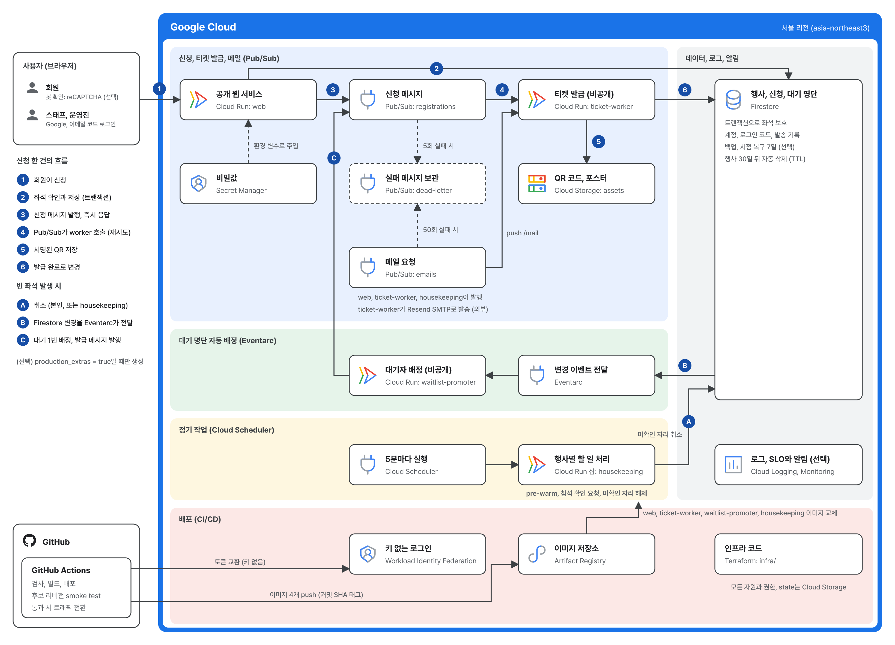

# Cloud Ticketing 실습

완성된 행사 신청 서비스를 자신의 Google Cloud 프로젝트에 올리고, 직접 신청하고 취소하면서 요청 하나가 클라우드의 어디를 지나가는지 따라갑니다.

## 구성



| 구성 요소 | 하는 일 |
|---|---|
| `web` (Cloud Run 서비스, 공개) | 신청 페이지와 API. 좌석을 Firestore에 저장하고 티켓 발급 요청 메시지를 남긴 뒤 바로 응답 |
| Pub/Sub `registrations` 주제와 `ticket-worker` 구독 | 메시지를 보관했다가 워커에 전달. 실패하면 재시도, 5번 실패하면 `dead-letter`로 |
| `ticket-worker` (서비스, 내부 전용) | QR 티켓을 만들고, `emails` 주제로 들어온 메일을 보냄 |
| Eventarc 트리거와 `waitlist-promoter` (서비스, 내부 전용) | 신청 문서가 바뀌면(취소) 대기 1번에게 자리를 줌 |
| Cloud Scheduler와 `housekeeping` (Cloud Run 잡) | 5분마다 마감 처리, 밀린 티켓 다시 보내기, 빈자리 채우기, 오픈 전 사전 준비 |
| Firestore | 행사, 신청, 좌석 카운터 |
| Secret Manager | 메일 키(`smtp-password`)와 앱의 비밀 값 |
| 서비스 계정 8개 | 구성 요소마다 하나씩, 필요한 권한만 |
| GitHub Actions (내 저장소) | 풀 리퀘스트마다 검사, `main`에 병합하면 이미지 빌드와 배포 |
| Resend (외부 메일 서비스) | 실제 메일 발송 |

인프라는 Terraform이 한 번 만들고(`./lab up`), 앱은 GitHub Actions가 배포합니다.

## 핵심 7가지

| | 장면 | 과제 | 배우는 것 |
|---|---|---|---|
| 1 | GitHub와 Google Cloud를 콘솔에서 키 없이 연결하고, 다른 브랜치가 거부되는 것 보기 | 2 | 키 없는 배포, 신뢰 조건 |
| 2 | 신청 하나를 따라가고, 대기열을 워커에 직접 연결해 403 고치기 | 4 | 비동기 처리, 인그레스와 IAM |
| 3 | 워커를 고장 내고 재시도와 dead letter 보기 | 5 | 실패한 메시지의 보관, 멱등성 |
| 4 | 취소하면 대기자에게 자리와 메일이 가는 것 보기 | 6 | 이벤트 기반 설계 |
| 5 | 테스트가 막는 버그와 0% 배포가 막는 문제, 그리고 되돌리기 | 7 | CI와 CD, 리비전, 롤백 |
| 6 | 콜드 스타트 재고, 오픈 전 사전 준비 보기 | 8 | 0까지 축소, 콜드 스타트, 비용 |
| 7 | 300명의 동시 신청 | 9 | 자동 확장, 처리량의 한계 |

---

# 1부. 준비

## 과제 0. 프로젝트, 예산, 내 저장소, 한 번에 만들기

**할 일.**
1. ☰ → **IAM 및 관리자 → 프로젝트 만들기**. 이름을 넣고 아래 **프로젝트 ID**를 적어 둡니다. **만들기**.
2. 위쪽 프로젝트 메뉴에서 새 프로젝트를 고릅니다.
3. ☰ → **결제**. 결제 계정이 연결되어 있지 않다고 나오면 **결제 계정 연결**로 무료 체험 계정을 연결합니다.
4. ☰ → **결제** → 왼쪽 **Budgets & caps** → **Create new**.
   - **정의**: **알림만**. 이름은 자유. **다음**
   - **범위**: **프로젝트**에서 실습 프로젝트만 체크. **다음**
   - **금액**: 목표 금액 `12000`. **다음**
   - **작업**: 기본값(50%, 90%, 100%) → **완료**
5. 내 저장소를 만듭니다. [github.com/joyrla/gdgoc-tickets-lab](https://github.com/joyrla/gdgoc-tickets-lab) → 오른쪽 위 **Use this template** → **Create a new repository**.
   - **Owner**: 자신의 계정
   - **Repository name**: `gdgoc-tickets`
   - **Public**
   - **Create repository**
6. 콘솔 오른쪽 위 **Cloud Shell 활성화**(>_)를 누르고 아래를 실행합니다.

   ```bash
   gh auth login --web --scopes workflow
   gh repo clone gdgoc-tickets
   cd gdgoc-tickets
   ./lab up
   ```

   - `gh auth login`: Enter만 누르다가 8자리 코드가 나오면 새 탭에서 [github.com/login/device](https://github.com/login/device) → 코드 입력 → **Continue** → **Authorize github**. `Logged in as`가 나오면 다음 줄로 넘어갑니다. `Failed to copy` 경고는 무시합니다.
   - `./lab up`: 프로젝트 이름과 ID를 보여 주고 묻습니다. 1번의 프로젝트가 맞으면 `y`. 아니면 Enter를 누르고, 콘솔 위쪽에서 프로젝트를 고른 뒤 Cloud Shell을 다시 엽니다.

`./lab up`은 Terraform으로 서비스 3개, 잡, 주제와 구독, Eventarc 트리거, 예약 실행, 서비스 계정 8개, 보안 비밀, 권한을 만듭니다. 서비스는 Google의 예시 이미지로 시작하고, 실제 앱은 과제 2에서 GitHub Actions가 처음 배포합니다. 기다리는 동안 과제 1을 합니다.

**멈추면 `./lab up`을 다시 실행합니다.** 만든 것은 그대로 두고 이어서 진행합니다. Cloud Shell은 입력 없이 40분이 지나면 종료되므로 가끔 Enter를 누릅니다.

**콘솔 준비.** ☰ → **모든 제품 보기**에서 Pub/Sub, Eventarc, Cloud Scheduler, 로깅의 ☆를 눌러 두면 ☰ 위쪽에 나타납니다.

**확인.** 마지막 줄의 사이트 주소를 열면 Google의 예시 화면이 보입니다.

**이유.** 예산은 알림만 보냅니다. 서비스를 멈추지는 않습니다. **"전체 계정으로 업그레이드"는 누르지 않습니다.**

**막히면.**

| 메시지 | 해결 |
|---|---|
| `No project is selected` 또는 다른 프로젝트 이름 | 콘솔 위쪽에서 실습 프로젝트를 고르고 Cloud Shell을 다시 엶 |
| `no billing account linked` | 할 일 3번 |
| `Could not resolve to a Repository` | 할 일 5번을 아직 안 함, 또는 이름이 `gdgoc-tickets`가 아니거나 Owner가 다른 계정 |
| `Google Cloud is not ready yet` | 새 프로젝트에서 흔함. 명령이 1분 뒤 스스로 다시 시도 |
| Cloud Shell이 끊김 | 다시 열고 `cd ~/gdgoc-tickets && ./lab up`. 잠금 해제를 물으면 `y` |

## 과제 1. 둘러보기 (선택, `./lab up`이 도는 동안)

만들어질 것을 미리 봅니다. `./lab up`이 끝낸 부분부터 콘솔에 나타납니다.

**할 일.** 아래 다섯 질문의 답을 콘솔에서 찾아 적습니다.

1. ☰ → **Cloud Run → 서비스** → `web` → **보안** 탭: `web`은 어떤 서비스 계정으로 실행되나요?
2. ☰ → **Pub/Sub → 주제** → `registrations` → 오른쪽 **권한**: 누가 이 주제에 메시지를 보낼 수 있나요?
3. ☰ → **Pub/Sub → 구독** → `ticket-worker` → **세부정보**: 전송 유형은 무엇이고, 몇 번 실패하면 어디로 가나요?
4. ☰ → **Cloud Run → 서비스** → `ticket-worker`를 체크 → **권한**: 누가 `ticket-worker`를 부를 수 있나요? 그 계정을 지금 쓰고 있는 구독은 어느 것인가요? (힌트: Pub/Sub의 `mailer` 구독)
5. ☰ → **Eventarc → 트리거** → `registration-changed`: 어떤 변경에 반응하나요?

<details>
<summary>답 확인</summary>

1. `tickets-web`. 서비스마다 자기 서비스 계정으로 실행됩니다.
2. `tickets-web`, `tickets-waitlist-promoter`, `tickets-housekeeping`(Pub/Sub 게시자). 신청, 대기자 배정, 밀린 티켓 다시 보내기가 모두 이 주제로 메시지를 보냅니다.
3. **가져오기**(Pull). 5번 실패하면 `dead-letter` 주제로 옮겨집니다. 과제 4에서 푸시로 바꿉니다.
4. `tickets-pubsub-push`(Cloud Run 호출자). 지금은 `mailer` 구독(메일)이 이 계정으로 서명해 `ticket-worker`를 부릅니다. `ticket-worker` 구독은 아직 가져오기라서 쓰지 않습니다.
5. Firestore 문서가 바뀔 때(`document.v1.updated`), 그중 `registrations/` 아래 문서만. 바뀐 내용은 `waitlist-promoter`로 갑니다.
</details>

(선택) `./lab iam`은 계정마다 가진 권한과 그 이유를 한 표로 보여 줍니다.

**이유.** 콘솔은 구성 요소마다 따로 보여 주므로, 구성 요소 사이의 연결은 이 다섯 질문처럼 직접 따라가야 보입니다.

---

# 2부. 연결

## 과제 2. GitHub와 Google Cloud 연결, 첫 배포

**문제.** GitHub Actions가 내 프로젝트에 배포하려면 Google Cloud에 로그인해야 합니다. 서비스 계정 키를 GitHub에 넣으면, 그 키가 새는 순간 누구나 배포할 수 있습니다. 그래서 키 대신 신뢰 관계를 만듭니다. "이 저장소의 `main`에서 온 GitHub Actions 실행만 배포 계정으로 인정"이라는 규칙입니다.

**할 일. 연결 전 시험**
1. 내 저장소 → **Actions** → 왼쪽 **Sign-in test** → **Run workflow** → **Run workflow**. 아직 연결이 없으므로 실패합니다.
2. 실패한 실행 → **sign-in** → **What GitHub says about this run** 단계를 펼칩니다. `repository_id:` 뒤의 숫자가 `저장소_ID`입니다. 적어 둡니다. GitHub이 실행마다 토큰에 넣어 Google Cloud에 보내는 값입니다.

**할 일. 신뢰 관계 만들기 (콘솔)**

3. ☰ → **IAM 및 관리자 → 워크로드 아이덴티티 제휴** → **풀 만들기**.
   - **ID 풀 만들기**: **이름** `github`. **풀 ID**도 `github`가 됩니다. **계속**
   - **풀에 공급업체 추가**: **공급업체 선택** → **OpenID Connect(OIDC)**. **제공자 이름** `gdgoc-tickets`(**제공업체 ID**도 `gdgoc-tickets`). **발급자(URL)** `https://token.actions.githubusercontent.com`. **대상**은 **기본 잠재고객** 그대로. **계속**
   - **공급업체 속성 구성**: 속성 매핑을 세 줄로 채웁니다. 두 번째, 세 번째 줄은 **매핑 추가**로 만듭니다.

     | Google | OIDC |
     |---|---|
     | `google.subject` | `assertion.sub` |
     | `attribute.repository_id` | `assertion.repository_id` |
     | `attribute.ref` | `assertion.ref` |

   - **속성 조건** → **조건 추가** → **조건 CEL**에 아래를 넣고 `저장소_ID`만 2번의 숫자로 바꿉니다. → **저장**

     ```
     assertion.repository_id == '저장소_ID' && assertion.ref == 'refs/heads/main'
     ```

4. 방금 만든 풀 `github` 화면 → **액세스 권한 부여** → **서비스 계정 가장 기능을 사용하여 액세스 권한 부여**.
   - **서비스 계정 선택**: `tickets-deployer`
   - **주 구성원 선택**: 속성 이름 `repository_id`, 속성 값 `저장소_ID`
   - **저장**. 구성 파일을 내려받으라는 창이 나오면 내려받지 않고 닫습니다.

**할 일. GitHub에 알려 주기**

5. 내 저장소 → **Settings** → 왼쪽 **Secrets and variables → Actions** → **Variables** 탭 → **New repository variable**로 세 개를 추가합니다. 비밀이 아니므로 **Secrets** 탭이 아니라 **Variables** 탭입니다.

   | 이름 | 값 | 찾는 곳 |
   |---|---|---|
   | `GCP_PROJECT_ID` | `프로젝트_ID` | 콘솔 위쪽 프로젝트 메뉴 |
   | `WIF_PROVIDER` | `projects/프로젝트_번호/locations/global/workloadIdentityPools/github/providers/gdgoc-tickets` | `프로젝트_번호`는 ☰ → **Cloud 개요 → 대시보드**의 **프로젝트 정보** |
   | `DEPLOYER_SA` | `tickets-deployer@프로젝트_ID.iam.gserviceaccount.com` | ☰ → **IAM 및 관리자 → 서비스 계정** |

6. 2분 기다린 뒤 **Sign-in test**를 다시 실행합니다. 이번에는 통과합니다.
7. 다른 브랜치에서 시험합니다. 내 저장소 첫 화면 → 왼쪽 위 브랜치 메뉴(**main**) → `try-branch` 입력 → **Create branch try-branch from main**. **Actions** → **Sign-in test** → **Run workflow** → **Branch** `try-branch` → **Run workflow**. 실패합니다. 실패한 단계의 오류를 찍습니다(**제출 1**). 그다음 브랜치 메뉴 → **View all branches** → `try-branch` 행의 휴지통 아이콘.
8. 배포를 켭니다. **Variables** 탭 → **New repository variable**: `DEPLOY_ENABLED` = `true`.

**할 일. 첫 배포 (풀 리퀘스트)**

내 컴퓨터에 Git과 VS Code가 필요합니다. Mac은 터미널에서 `git --version`을 실행하면 설치 창이 뜹니다. Windows는 [git-scm.com](https://git-scm.com/downloads)에서 기본 설정으로 설치합니다.

9. VS Code → 위쪽 메뉴 **Terminal → New Terminal**. 이름과 이메일을 설정하고(처음 한 번), 내 저장소를 받습니다. `GitHub_사용자명`은 GitHub 로그인 이름입니다(2번의 숫자 `저장소_ID`가 아님).

   ```bash
   git config --global user.name "내 이름"
   git config --global user.email "GitHub에 등록한 이메일"
   git clone https://github.com/GitHub_사용자명/gdgoc-tickets.git
   ```

10. **File → Open Folder** → 홈 폴더의 `gdgoc-tickets`. **Terminal → New Terminal**을 다시 열고 새 브랜치를 만듭니다.

    ```bash
    git switch -c first-deploy
    ```

11. `web/templates/home.html`의 7번째 줄 `행사를 찾아 신청하고 QR 티켓으로 입장하세요.`를 원하는 문장으로 바꾸고 저장합니다.
12. 커밋하고 GitHub에 올립니다. 처음 올릴 때 GitHub 로그인 창이 뜨면 브라우저에서 로그인하고 승인합니다.

    ```bash
    git commit -am "First deploy"
    git push -u origin first-deploy
    ```

13. 출력에 나온 `https://github.com/GitHub_사용자명/gdgoc-tickets/pull/new/first-deploy`를 엽니다 → **Create pull request**. 아래에 검사(**Checks**)가 돕니다. 이 단계에서는 배포하지 않습니다.
14. 검사가 모두 초록색이면 **Merge pull request** → **Confirm merge**.

**볼 곳.** **Actions** → `main`에서 시작된 **CI/CD** 실행 → `deploy` 작업의 단계. ☰ → **Cloud Run** → `web` → **업데이트 기록** 탭.

**확인.** 배포가 끝나면 모든 작업이 초록색이고, 사이트가 예시 화면에서 실제 사이트로 바뀌며 홈에 바꾼 문장이 보입니다. `web`의 새 리비전이 100%입니다. Cloud Shell에서 `./lab check github deploys`.

**이유.** GitHub은 실행마다 짧게 유효한 토큰을 주고, 그 안에 저장소 ID와 브랜치가 들어 있습니다. 3번의 공급업체는 토큰이 GitHub에서 왔는지(발급자) 확인하고, 속성 조건(내 저장소 ID, `main`)에 맞는 토큰만 받습니다. 4번의 권한 부여로 그런 토큰만 `tickets-deployer`로 가장할 수 있습니다. 저장한 키가 없으므로 유출되거나 교체할 키도 없습니다. 이름이 아닌 ID를 쓰는 것은, 저장소를 지운 뒤 누가 같은 이름으로 만들어도 통과하지 못하게 하기 위해서입니다. 풀 리퀘스트에서는 검사만 돌고, `main`에 병합해야 배포됩니다. 그래서 `main`은 늘 검사를 통과한 코드입니다.

**막히면.**

| 증상 | 해결 |
|---|---|
| 다시 실행한 Sign-in test가 `rejected by the attribute condition` | 조건의 `저장소_ID`가 2번의 숫자와 같은지, 작은따옴표로 감쌌는지 |
| `Permission 'iam.serviceAccounts.getAccessToken' denied` | 권한이 퍼지는 중이면 2분 뒤 다시. 계속되면 4번의 속성 값이 `저장소_ID`인지 |
| `invalid_target` 또는 공급업체를 찾지 못함 | `WIF_PROVIDER`의 `프로젝트_번호`(ID가 아님)와 철자 |
| `deploy` 작업이 건너뛰어짐 | `DEPLOY_ENABLED`가 정확히 `true`인지 |
| `emulator` 작업이 `Transaction lock timeout`으로 실패 | 시험용 데이터베이스의 일시적인 지연. 실행 화면의 **Re-run failed jobs** |
| `git`을 찾을 수 없음 | Git을 설치한 뒤 VS Code를 다시 시작 |
| 콘솔 단계에서 막힘 | Cloud Shell에서 `./lab github`이 같은 연결을 대신 만들고 변수 값을 보여 줍니다 |

## 과제 3. 메일 연결

지금은 메일이 꺼져 있어서, 보낼 메일은 로그에 `not sent`로만 남습니다. 스터디장이 개인 메시지로 보낸 **메일 키**와 **보내는 주소**를 씁니다. 키는 비밀번호와 같습니다. 채팅, 코드, 스크린샷에 넣지 않습니다.

**할 일.**
1. ☰ → **보안 → Secret Manager** → `smtp-password` → **버전** 탭 → **새 버전** → 값에 메일 키 → 추가.
2. `mail-from` → **새 버전** → 값에 보내는 주소 → 추가.
3. 메일을 켭니다.

   ```bash
   ./lab mail on
   ```

4. **앱에서 할 일.** 사이트 → 위쪽 **로그인** → **이메일**에 콘솔에 로그인한 Google 계정의 주소 → **코드 받기**.

**오는 메일.** `[Cloud Ticketing] 인증 코드 123456`. 코드를 **인증 코드**에 넣고 **확인**. 위쪽 메뉴에 **관리**가 생깁니다. `./lab up`이 그 계정을 운영진으로 등록해 두었습니다.

**볼 곳.** `smtp-password` → **권한** 탭. ☰ → **Cloud Run** → `ticket-worker`와 `web` → **컨테이너** 탭의 **변수 및 보안 비밀**.

**확인.** 키를 읽을 수 있는 것은 `tickets-ticket-worker` 하나입니다. `web`에는 메일 키가 연결되어 있지 않습니다. `./lab check mail`.

**이유.** 외부 서비스의 키는 코드나 환경 변수에 직접 넣지 않고 Secret Manager에 둡니다. 키를 바꿀 때는 새 버전을 추가하고, 서비스는 시작할 때 그 값을 읽습니다. 코드 메일도 `web`이 직접 보내지 않습니다. `web`은 `emails` 주제에 메시지를 남기고, `mailer` 구독이 `ticket-worker`에 전달하면 워커가 Resend로 보냅니다. 키를 읽는 권한이 그 워커 하나에만 있어서, `web`이 침해되어도 메일 키는 새지 않습니다.

---

# 3부. 따라가기

**앱에서 할 일**은 사이트에서 누를 버튼, **오는 메일**은 그 결과로 메일함에 와야 할 메일입니다. 메일 제목은 모두 `[Cloud Ticketing]`으로 시작합니다.

## 과제 4. 신청 하나 따라가기, 대기열 연결

**앱에서 할 일.**
1. 위쪽 **관리** → **새 행사 만들기**.
   - **행사 이름**: `연결 확인`
   - **주소**: `wiring`
   - **장소**: `온라인`
   - 일정과 정원은 기본값 그대로
   - 맨 아래 **공개** 체크 → **행사 만들기**
2. **행사 페이지** → **신청하기**. **이름**이 비어 있으면 채우고, **개인정보 수집 및 이용에 동의합니다** 체크 → **신청하기**. 이메일은 로그인한 Gmail로 채워져 있습니다.
3. **티켓 보기**.

**오는 메일.** 없음.

**볼 곳.**
- ☰ → **Firestore** → `(default)` → **Firestore Studio** → `registrations`: 방금 신청한 문서와 `status`
- ☰ → **Pub/Sub → 구독** → `ticket-worker` → **메시지** 탭 → **가져오기**. **확인 메시지 사용 설정**은 체크하지 않습니다. 가져오기는 한 번만 누릅니다(누를 때마다 전달 시도로 셉니다).

**확인.** 티켓은 **티켓 발급 중**에 머물고, 메일은 오지 않습니다. 구독에 `{"registration_id": ...}` 메시지 하나가 기다립니다. `web`은 좌석을 저장하고 메시지를 남긴 뒤 바로 응답했지만, 구독이 **가져오기**(Pull)라서 메시지는 누가 가져갈 때까지 보관됩니다.

**할 일. 대기열을 워커에 연결 (직접)**
1. ☰ → **Cloud Run → 서비스** → `ticket-worker`의 **URL**을 복사합니다.
2. ☰ → **Pub/Sub → 구독** → `ticket-worker` → **수정**.
3. **전송 유형**: **푸시**. **엔드포인트 URL**: 복사한 URL. **인증 사용 설정**은 **체크하지 않은 채로** → **업데이트**.

**볼 곳.** ☰ → **Cloud Run** → `ticket-worker` → **모니터링 가능성** 탭의 로그.

**확인.** `403`과 `The request was not authenticated`가 반복됩니다. 메일은 여전히 없습니다. 2~3번 보이면 로그를 찍고(**제출 2**) 바로 고칩니다. 실패가 5번 쌓이면 메시지는 `dead-letter`로 옮겨집니다.
1. 구독 → **수정** → **인증 사용 설정** 체크 → **서비스 계정** `tickets-pubsub-push` → **업데이트**.
2. 처음 신청을 기다립니다. 새로 신청하지 않습니다.

**오는 메일.** 고친 뒤 곧 `신청 완료: 연결 확인`. 메일의 링크를 열면 티켓에 QR이 보입니다.

**이유.** 신청과 티켓 발급은 메시지로 나뉘어 있어서, 발급이 느리거나 멈춰도 신청은 받습니다. 신청 완료 메일은 티켓을 발급한 워커가 보내므로, 메시지가 워커에 닿기 전에는 메일도 없습니다. `ticket-worker`는 인그레스가 **내부**라서 Pub/Sub의 요청은 들어올 수 있습니다(인터넷에서는 404). 하지만 **인증 필요**라서 서명 없는 요청은 403입니다. 서명을 켜면 Pub/Sub가 `tickets-pubsub-push`로 서명하고, 이 계정은 `ticket-worker`의 **Cloud Run 호출자**입니다. 네트워크 진입 허용(인그레스)과 호출 권한(IAM)은 별개의 설정입니다.

> **제출 2 스크린샷:** `403` 로그(고치기 전), QR이 보이는 티켓(고친 뒤)

**막히면.** 고친 뒤에도 메일이 없고 티켓이 계속 "발급 중"이면 메시지가 이미 `dead-letter`로 갔습니다. 과제 5의 다시 보내기로 돌려보냅니다.

## 과제 5. 워커 장애와 dead letter

**할 일.**
1. ☰ → **Cloud Run** → `ticket-worker` → **컨테이너** 탭 → **변수 및 보안 비밀** → **변수 추가**: `WORKER_FAIL_RATE` = `1`.
2. 오른쪽 위 **차이점 확인 및 재배포** → 바뀐 줄을 확인 → **변경사항 배포**.

**앱에서 할 일.** 브라우저 **시크릿 창**에서 사이트 → **연결 확인** → **신청하기** → **이름** 아무거나, **이메일** `you+b@gmail.com`(Gmail은 `+` 뒤의 글자와 관계없이 같은 메일함으로 보냅니다) → 동의 체크 → **신청하기** → **티켓 보기**.

**오는 메일.** 고치기 전에는 없음.

**볼 곳.**
- `ticket-worker` 로그: `simulated failure`와 `500`
- 구독 `ticket-worker` → **데드 레터 처리** 탭: 실패한 메시지가 갈 곳
- `500`이 멈춘 뒤 구독 `dead-letter` → **메시지** → **가져오기**(**확인 메시지 사용 설정** 체크 해제)

**확인.** 신청은 성공합니다. `500`이 몇 번 반복되다가 멈추고, 메시지가 `dead-letter`에 있습니다. 고치기 전에 이 두 화면을 찍습니다(**제출 3**).

이제 고칩니다.
1. **컨테이너** 탭에서 `WORKER_FAIL_RATE`를 지우고 → **차이점 확인 및 재배포** → **변경사항 배포**.
2. 1분 기다린 뒤(가져오기로 본 메시지는 1분 동안 숨겨집니다) 실패한 메시지를 원래 주제로 다시 보냅니다.
   - 구독 `dead-letter` → **메시지** 탭 → **확인 메시지 사용 설정** 체크 → **가져오기**. 가져온 메시지는 `dead-letter`에서 삭제됩니다. 메시지 본문 `{"registration_id": "..."}`를 복사합니다.
   - ☰ → **Pub/Sub → 주제** → `registrations` → **메시지** 탭 → **메시지 게시** → 메시지 본문에 붙여넣기 → **게시**.

**오는 메일.** 다시 보내고 몇 초 뒤 `you+b@gmail.com` 앞으로 `신청 완료: 연결 확인`. 몇 분 뒤 로그에서 `skip ... (status issued)`를 찾아봅니다.

**이유.** 신청과 발급이 메시지로 나뉘어 있어서, 워커가 고장 나도 신청은 받습니다. 재시도는 잠깐의 실패를 고치고, 고칠 수 없는 실패는 5번 뒤 `dead-letter`에 남아 사람이 봅니다. `skip`은 5분마다 도는 잡이 밀린 티켓을 한 번 더 보낸 흔적입니다. 같은 메시지가 두 번 와도 워커가 발급 여부를 먼저 확인하므로 티켓도 메일도 하나입니다(멱등성).

> **제출 3 스크린샷:** 반복되는 `500` 로그, `dead-letter`에서 기다리는 메시지(둘 다 고치기 전)

## 과제 6. 취소와 이벤트

**문제.** 누가 취소하면 대기 1번에게 자리가 가야 합니다. 취소는 신청자, 관리자, 마감 처리 등 여러 곳에서 일어납니다.

**앱에서 할 일.**
1. 일반 창: **관리** → **새 행사 만들기**. **행사 이름** `대기 배정 확인`, **주소** `promo`, **장소** `온라인`, **정원** `1`, **대기 정원** `1`, **공개** 체크 → **행사 만들기**.
2. 일반 창: **행사 페이지** → **신청하기** → 동의 체크 → **신청하기** → **티켓 보기**. 이 탭을 열어 둡니다.
3. 시크릿 창: 사이트 → **대기 배정 확인** → **대기 신청하기** → **이메일** `you+c@gmail.com` → 동의 체크 → **대기 신청하기** → **티켓 보기**. **대기 1번**이 보입니다.
4. 일반 창의 티켓 화면 아래 **신청 취소** → "신청을 취소할까요?" → **확인**.

**오는 메일.**

| 언제 | 받는 주소 | 제목 | 보낸 곳 |
|---|---|---|---|
| 2 뒤 | `you@gmail.com` | `신청 완료: 대기 배정 확인` | `ticket-worker` (티켓 발급 후) |
| 3 뒤 | `you+c@gmail.com` | `대기 신청 완료: 대기 배정 확인` | `web` |
| 4 뒤 | `you@gmail.com` | `신청 취소: 대기 배정 확인` | `web` |
| 4 뒤 몇 초 | `you+c@gmail.com` | `자리 배정: 대기 배정 확인` | `ticket-worker` (대기자에게 발급 후) |

**볼 곳.** 시크릿 창의 티켓 화면(새로고침), `waitlist-promoter` 로그, Firestore Studio의 `registrations`에서 두 문서의 `status`.

**확인.** 몇 초 안에 시크릿 창의 티켓에 QR이 나타나고 `자리 배정` 메일이 옵니다.

**이유.** 취소로 Firestore 문서가 바뀌면 Eventarc가 그 변경을 `waitlist-promoter`에 전달합니다. `waitlist-promoter`는 대기 1번에게 자리를 주고 `registrations` 주제에 메시지를 남깁니다. 그 뒤 티켓과 `자리 배정` 메일은 과제 4~5와 같은 길로 나갑니다. `web`은 대기자 처리를 모릅니다. 데이터가 바뀐 것 자체에 반응하므로, 취소가 어디서 일어나든 한 곳에서 처리됩니다. 전달이 실패해도 5분마다 도는 잡이 빈자리를 채웁니다.

## 과제 7. 풀 리퀘스트, 검사, 안전한 배포

**문제.** 테스트를 통과한 코드도 실제 환경에서는 실패할 수 있습니다. 실수 두 가지를 일부러 넣고, 각각 어디서 막히는지 봅니다.

**할 일. 테스트가 막는 버그 (CI)**
1. VS Code 터미널에서 `main`을 최신으로 받고 새 브랜치를 만듭니다.

   ```bash
   git switch main
   git pull
   git switch -c seat-bug
   ```

2. `shared/models.py` 121번째 줄의 `held < self.seat_limit`을 `held <= self.seat_limit`로 바꿉니다. 정원이 찬 뒤에도 한 명 더 받는 버그입니다.
3. 커밋하고 올린 뒤, 출력의 링크로 풀 리퀘스트를 만듭니다.

   ```bash
   git commit -am "Seat bug"
   git push -u origin seat-bug
   ```

**확인.** 검사의 `test`와 `emulator` 작업이 빨간색입니다. 빨간 표시의 설명은 `Process completed with exit code 1.`뿐이므로 `test` 작업의 로그를 엽니다. 첫 실패는 `test_never_oversells_under_concurrency`, 오류는 `assert 31 == 30`(정원 30에 31명)입니다. 빨간 검사가 있어도 병합 버튼은 눌립니다. 병합하지 않고 **Close pull request**로 닫습니다. `main`과 사이트는 그대로입니다.

**할 일. 테스트로는 못 막는 문제 (CD)**
4. `main`에서 새 브랜치를 만듭니다.

   ```bash
   git switch main
   git switch -c wrong-port
   ```

5. `Dockerfile` 42번째 줄(`web` 단계)의 `--port ${PORT:-8080}`을 `--port 3000`으로 바꿉니다. 컨테이너가 Cloud Run이 기다리는 8080이 아닌 다른 포트에서 응답하게 되는 실수입니다.
6. 커밋하고 올린 뒤 풀 리퀘스트를 만듭니다. 검사는 모두 초록색입니다. **Merge pull request** → **Confirm merge**.

   ```bash
   git commit -am "Wrong port"
   git push -u origin wrong-port
   ```

**볼 곳.** **Actions** → `main`의 **CI/CD** → `deploy` 작업. ☰ → **Cloud Run** → `web` → **업데이트 기록** 탭.

**확인.** 새 리비전이 트래픽 0%로 시작하다가 실패합니다. 실패한 단계는 **Start the new revisions with no traffic**이고, 로그의 오류는 `The user-provided container failed the configured startup probe checks`입니다. 그 리비전의 로그에는 `STARTUP HTTP probe failed ... on port 8080 path "/health"`가 있습니다. Cloud Run은 8080 포트의 `/health`에 응답해야 시작된 것으로 보는데, 컨테이너는 3000에서 기다렸습니다. 이어서 **Put everything back**이 실행되고 트래픽은 이전 리비전에 남습니다. 사이트는 계속 열립니다. 이때의 **업데이트 기록** 탭과 실패한 단계를 찍습니다(**제출 4**).

**할 일. 되돌리기**
7. GitHub → 병합된 풀 리퀘스트 `wrong-port` 화면 아래 **Revert** → **Create pull request** → 검사가 초록색이면 **Merge pull request** → **Confirm merge**.

**확인.** 다음 배포는 새 리비전을 0%로 올려 검사한 뒤 100%로 바꿉니다.

**이유.** CI(풀 리퀘스트의 검사)는 코드의 잘못을 `main`에 들어가기 전에 막습니다. 하지만 포트처럼 실제 환경에서만 드러나는 잘못도 있습니다. CD(배포)는 새 버전을 리비전으로 띄우되 트래픽은 0%로 두고, 시작과 검사를 통과해야만 트래픽을 옮깁니다. 실패하면 트래픽은 이전 리비전에 남으므로 사용자는 아무것도 겪지 않습니다. 리비전과 트래픽은 별개의 설정이라, 롤백은 빌드 없이 트래픽만 옮기는 일입니다. **Revert**는 그 변경을 되돌리는 새 변경을 같은 길로 내보냅니다.

> **제출 4 스크린샷:** 실패한 배포 단계와 그때의 **업데이트 기록** 탭(실패한 리비전, 트래픽은 이전 리비전 100%)

## 과제 8. 콜드 스타트와 사전 준비

**콜드 스타트.** 사이트를 15분 넘게 열지 않은 상태에서 먼저 합니다.

```bash
./lab coldstart
```

**확인.** 첫 요청은 몇 초, 이후는 0.1초 안쪽. 측정표에 적습니다.

**사전 준비.**
1. 10분 뒤에 신청이 열리는 행사를 만듭니다. 사전 준비는 오픈 15분 전부터입니다. 사이트 → **관리** → **새 행사 만들기**: **행사 이름** `오픈 준비 확인`, **주소** `opening`, **장소** `온라인`, **신청 시작**은 지금부터 10분 뒤, **공개** 체크 → **행사 만들기**.

2. ☰ → **Cloud Scheduler** → `housekeeping` 행을 체크 → **강제 실행**. 기다리지 않고 잡을 바로 실행합니다.
3. ☰ → **Cloud Run → 작업** → `housekeeping` → **기록** 탭 → 방금 실행 → 로그.

**확인.** 로그에 `pre-warm: web minimum instances 0 → 3`. `web` → **모니터링 가능성**의 인스턴스 수 그래프에 3개가 떠 있습니다. 오픈 1시간 뒤 잡이 다시 0으로 돌립니다.

**이유.** 인스턴스가 0이면 첫 요청은 컨테이너 시작을 기다립니다. 0까지 줄어드는 덕분에 밤에는 비용이 없지만, 그 대가가 느린 첫 요청입니다. 오픈 시각을 알면 잡이 미리 인스턴스를 띄워 둡니다. 기다림은 없어지지만, 요청이 없는 동안에도 비용이 듭니다. 잡이 `web`의 설정을 바꿀 수 있는 것은 두 권한(읽기, 수정)만 담은 커스텀 역할 덕분입니다(`./lab iam`의 `housekeeping`).

> **제출 5 스크린샷:** `./lab coldstart` 출력, 오픈 전에 인스턴스 3개가 떠 있는 그래프

## 과제 9. 신청이 몰릴 때

**할 일.**
1. 사이트 → **관리** → **새 행사 만들기**: **행사 이름** `신청 몰림 A`, **주소** `rush-a`, **장소** `온라인`, **신청 시작**은 지금부터 3분 뒤, **정원** `100`, **대기 정원** `50`, **공개** 체크 → **행사 만들기**.
2. 바로 부하 테스트를 실행합니다. 방문자 300명이 오픈 전에 행사 페이지를 열어 두었다가, 열리는 순간 **신청하기**를 누릅니다.

   ```bash
   ./lab load rush-a
   ```

**오는 메일.** 없음. 가상 방문자의 주소는 `@example.com`입니다. 시험용으로 정해진 도메인이라 메일을 켜 두어도 보내지 않고, 로그에 `test address, not sent`로 남습니다.

**볼 곳.** (그래프는 3~5분 늦게 나타납니다)
- `web` → **모니터링 가능성**: 인스턴스 수, 요청 지연 시간
- 구독 `ticket-worker` → **측정항목**: 확인되지 않은 메시지 수
- Firestore Studio → `event_counts` → `rush-a`: `held`(좌석을 가진 신청)와 `issued`(발급된 티켓)

**확인.** Locust의 `Signups:` 줄과 응답 시간 표, `held` = `issued` = 100. 측정표에 적고 찍습니다(**제출 6**). 오픈 직전이라 사전 준비(과제 8)가 인스턴스 3개를 먼저 띄워 두었을 수 있습니다. 그래프에서 3개보다 몇 개 더 늘었는지 봅니다.

**이유.** Cloud Run은 인스턴스당 동시 요청을 보고 인스턴스를 늘립니다. 동시성이 낮으면 같은 부하에 인스턴스가 더 필요합니다. 신청 하나하나는 행사의 좌석 카운터 문서 하나를 트랜잭션으로 고치므로, 좌석은 정확하지만 초당 신청 수에는 한계가 있습니다. 인스턴스를 늘려도 그 한계는 그대로입니다.

> **제출 6 스크린샷:** `web`의 인스턴스 수 그래프, Locust 결과(`Signups:` 줄과 응답 시간 표)

---

# 제출

공지된 설문에 올립니다. **필수**는 점수에 들어가고, **선택**은 들어가지 않습니다.

## 필수 1. 핵심 개념 6개

개념마다 스크린샷 하나와 질문 하나입니다. 답은 3~5문장이면 충분합니다.

**점수:** 개념마다 3점. 스크린샷 1점, 답 2점(맞는 답이면 1점, 자신의 스크린샷이나 측정값을 근거로 이유까지 쓰면 2점).

**1. 키 없는 배포 (과제 2)**
- 스크린샷: **제출 1**. `try-branch`에서 실패한 Sign-in test
- 질문: 다른 사람의 저장소나 다른 브랜치가 내 프로젝트에 배포하지 못하게 막는 것은 무엇인가요? GitHub에 키를 저장하지 않아도 되는 이유는?

**2. 서비스 계정과 IAM (과제 4)**
- 스크린샷: **제출 2**. `ticket-worker` 로그의 `403`(고치기 전), QR이 보이는 티켓(고친 뒤)
- 질문: 요청을 들여보낸 설정과 403으로 막은 설정은 각각 무엇인가요? 어떤 계정의 어떤 역할이 요청을 통과시켰나요?

**3. Pub/Sub와 비동기 처리 (과제 5)**
- 스크린샷: **제출 3**. 반복되는 `500` 로그, `dead-letter`에서 기다리는 메시지
- 질문: 워커가 실패하는 동안 신청자가 겪은 일과 겪지 않은 일은 무엇인가요(신청 화면, 티켓, 메일)? 메시지는 마지막에 어디로 갔고, 왜 그곳으로 갔나요?

**4. CI, CD, 리비전 (과제 7)**
- 스크린샷: **제출 4**. 실패한 배포 단계와 **업데이트 기록** 탭
- 질문: 첫 번째 실수와 두 번째 실수는 각각 어디서 막혔고, 왜 두 번째는 검사를 통과했나요? 실패한 리비전을 본 사용자는 누구인가요?

**5. 콜드 스타트, 사전 준비, 비용 (과제 8)**
- 스크린샷: **제출 5**. `./lab coldstart` 출력, 오픈 전에 인스턴스 3개가 떠 있는 그래프
- 질문: 첫 요청은 왜 느렸나요? 사전 준비는 이것을 어떻게 막고, 그 대가는 무엇인가요? 사전 준비가 필요 없는 경우를 하나 쓰세요.

**6. 자동 확장과 처리량 (과제 9)**
- 스크린샷: **제출 6**. 인스턴스 수 그래프, Locust 결과
- 질문: 인스턴스는 몇 개까지, 왜 늘었나요? 인스턴스가 늘어도 초당 신청 수가 멈춘 이유는?

## 필수 2. 함께 낼 것

1. `~/lab-report.txt`. 과제를 마친 뒤 Cloud Shell에서 `./lab check --report`를 실행하면 생깁니다.
2. 측정표

   | | `rush-a` (동시성 40) | (선택) `rush-c` (동시성 2) |
   |---|---|---|
   | `web` 인스턴스 최대 수 | | |
   | 신청 응답 중앙값 (50%) | | |
   | 신청 응답 95% | | |
   | 초당 신청 수 최댓값 | | |

   콜드 스타트 첫 요청 / 이후 요청: ____ / ____.

3. 설계 질문 하나: **오픈 순간 신청자가 10배라면 무엇이 먼저 한계에 닿고, 무엇을 바꾸겠나요?** 자신의 측정값을 근거로 쓰세요.
4. 피드백 설문(개념별 자신감 1~5점, 가장 헷갈린 과제)

## 선택

| 과제 | 개념 | 질문 |
|---|---|---|
| 1 | 구성 | 다섯 질문의 답. 콘솔만 보고 알기 어려웠던 연결은? |
| 3 | Secret Manager | 메일 키를 읽을 수 있는 계정은? 키가 새었다면 무엇을 하나요? |
| 4 | 가져오기 구독 | 신청 응답은 왔는데 티켓과 메일은 왜 없었나요? 메시지는 어디에 있었나요? |
| 5 | 멱등성 | 같은 메시지가 두 번 와도 티켓과 메일이 하나인 이유는? |
| 6 | Eventarc | 대기자에게 자리를 준 것은 누구이고, 무엇이 그 일을 시작했나요? 메일 네 통 중 `web`이 보낸 것과 워커가 보낸 것이 나뉘는 이유는? |
| 8 | 잡과 Cloud Scheduler | `housekeeping`은 왜 서비스가 아니라 잡인가요? |

# 심화 (선택, 목표만)

- 과제 9를 동시성 2로 다시 재고(`rush-c`), 인스턴스 수와 응답 시간을 비교
- 행사가 꽉 찼을 때 트랜잭션 없이 "마감"을 답하게 바꾸고, 과제 9를 다시 측정
- 좌석 카운터를 문서 여러 개로 나누고 다시 측정
- 과제 5의 실패를 잡아냈을 알림 하나 추가
- 과제 2에서 콘솔로 만든 신뢰 관계를 Terraform 코드(`infra/`)에서 찾아, 코드로 만드는 방법 정리

# 정리

제출을 마치고 실습을 더 하지 않을 때, 실습이 만든 것을 모두 지웁니다.

1. Cloud Shell에서 실행합니다. 프로젝트 ID를 입력하면 시작합니다.

   ```bash
   cd ~/gdgoc-tickets
   ./lab down
   ```

2. 내 저장소 → **Settings** → 맨 아래 **Delete this repository**.
3. (선택) 프로젝트까지 지우려면 ☰ → **IAM 및 관리자 → 설정** → **종료**. 30일 뒤 완전히 삭제됩니다.

`./lab down`은 과제 2에서 콘솔로 만든 신뢰 관계와 과제 4의 푸시 설정까지 Terraform으로 넘겨받아 함께 지우고(`terraform destroy`), 남은 것이 없는지 확인한 뒤, Terraform 상태 버킷과 Cloud Shell의 설정을 지우고, GitHub의 배포를 끕니다. 중간에 멈추면 다시 실행합니다.

# 단축 명령 모음

모두 Cloud Shell의 `~/gdgoc-tickets`에서 실행합니다.

| 명령 | 하는 일 |
|---|---|
| `./lab up` | 인프라 전부 만들기. 다시 실행하면 코드의 설정으로 되돌림 |
| `./lab iam` | 계정마다 가진 권한과 이유 |
| `./lab github` | (선택) 과제 2의 키 없는 로그인을 대신 만들고 변수 값 출력 |
| `./lab mail on`, `./lab mail off` | 실제 메일 켜고 끄기 |
| `./lab load 행사_ID [--users N] [--minutes M]` | 부하 테스트 |
| `./lab coldstart` | 첫 요청과 이후 요청 시간 |
| `./lab check [이름]`, `./lab check --report` | 확인과 보고서 |
| `./lab code` | 운영진 로그인 코드(메일이 꺼져 있을 때) |
| `./lab down` | 실습이 만든 것 모두 지우기 |

# 참고. AWS와 비교

| AWS | 이 실습 (Google Cloud) |
|---|---|
| 계정 | 프로젝트 |
| App Runner, ECS Fargate 서비스 | Cloud Run 서비스 (`web`, 워커 둘) |
| ECS 작업 실행 | Cloud Run 잡 (`housekeeping`) |
| SNS + SQS | Pub/Sub. 주제가 SNS, 구독 하나하나가 SQS 큐 |
| SQS dead-letter queue | dead-letter 주제와 그 구독 |
| EventBridge 규칙 | Eventarc 트리거 |
| EventBridge Scheduler | Cloud Scheduler |
| DynamoDB | Firestore |
| Secrets Manager | Secret Manager |
| 서비스가 맡는 IAM 역할 | 서비스 계정 |
| 리소스 정책 (`lambda:InvokeFunction`) | 리소스에 준 역할 (`Cloud Run 호출자`) |
| GitHub OIDC 자격 증명 공급자 | 워크로드 아이덴티티 제휴 |
| CloudFormation 스택 | 콘솔에는 없음. Terraform 코드와 상태가 그 역할 |
